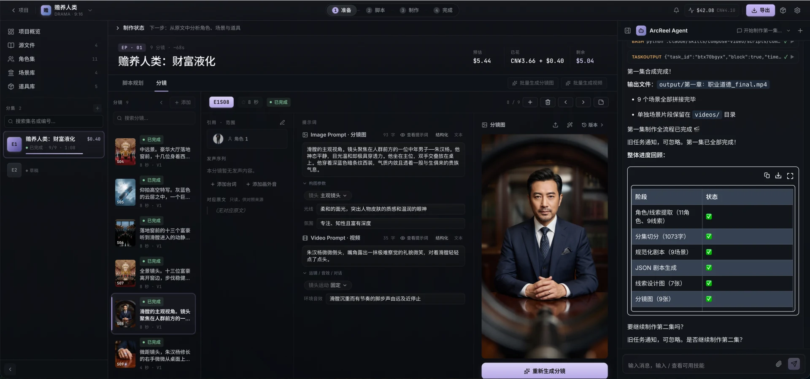
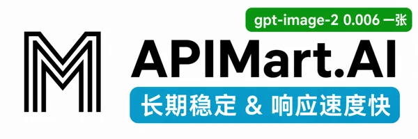
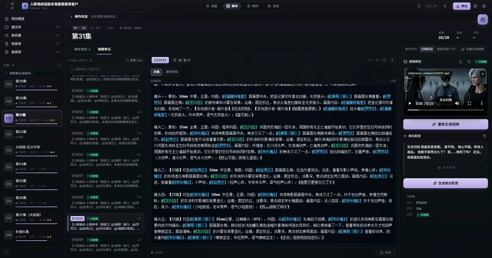
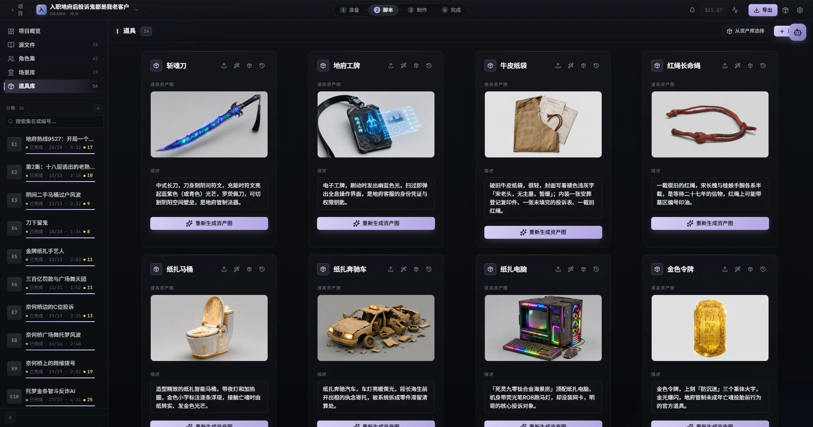
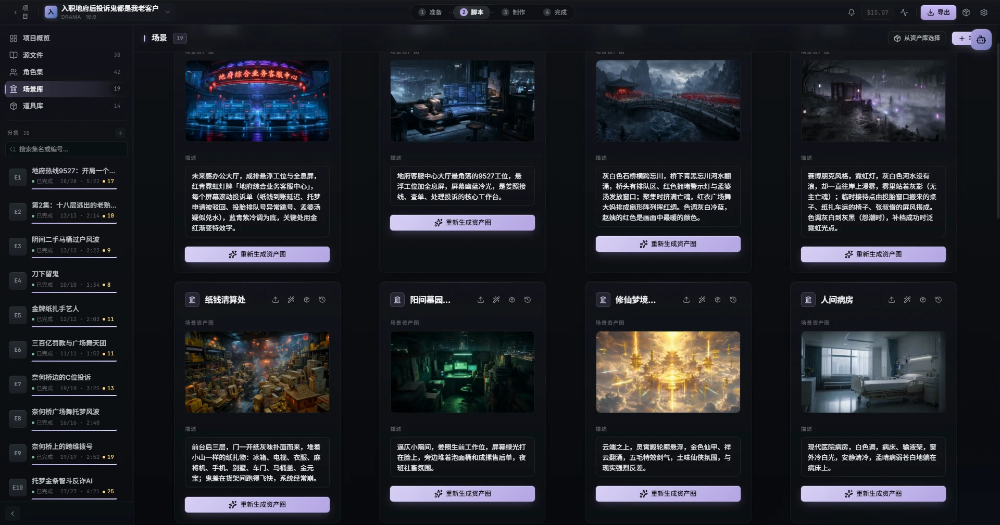
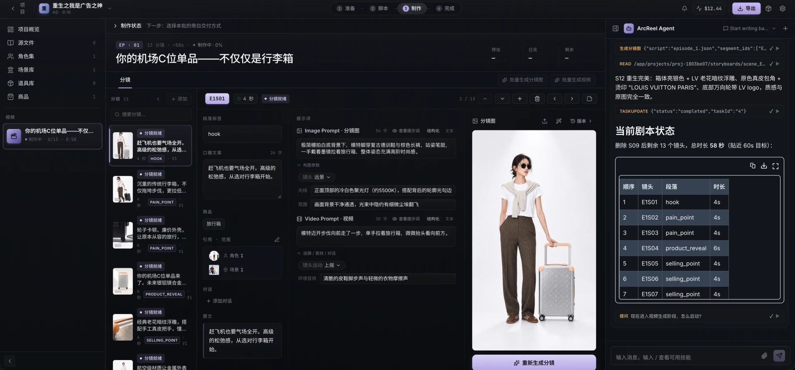

<h1 align="center">
  <br>
  <picture>
    <source media="(prefers-color-scheme: light)" srcset="docs/assets/logo-animated-light.svg">
    <source media="(prefers-color-scheme: dark)" srcset="frontend/public/logo-animated.svg">
    
  </picture>
  <br>
  ArcReel
  <br>
</h1>

<p align="center">
  <strong>An open-source, self-hosted AI video production workspace</strong>
  <br>
  Turn novels, finished screenplays, or product assets into character-consistent, controllable, cost-trackable short videos that remain editable.
</p>

<p align="center">
  <a href="README.md"></a>
  <a href="README.en.md"></a>
</p>

<p align="center">
  <a href="https://github.com/ArcReel/ArcReel/releases/latest"></a>
  <a href="https://github.com/ArcReel/ArcReel/actions/workflows/test.yml"></a>
  <a href="https://codecov.io/gh/ArcReel/ArcReel"></a>
  <a href="https://hub.docker.com/r/arcreel/arcreel"></a>
  <a href="LICENSE"></a>
  <a href="https://github.com/ArcReel/ArcReel"></a>
</p>

<p align="center">
  <a href="#quick-start"><strong>Quick Start</strong></a>
  ·
  <a href="https://docs.arc-reel.com/en/guide/getting-started">Getting Started</a>
  ·
  <a href="https://docs.arc-reel.com/en/">Documentation</a>
  ·
  <a href="#community">Community</a>
</p>

<p align="center">
  
</p>

## Sponsors

> [Want to appear here?](mailto:support@arc-reel.com)

<table>
  <tr>
    <td width="200" align="center" valign="top">
      <a href="https://metaso.cn/minimax-h3/?s=arc"></a>
    </td>
    <td valign="top">
      <strong>MiniMax H3 Video Generation API | Metaso</strong><br>
      Metaso offers cost-effective MiniMax H3 video generation: <strong>CNY 0.09/sec at 768P, CNY 0.15/sec at 2K</strong>. Native 2K, synchronized audio and video, an API compatible with the <strong>OpenAI protocol</strong>, and <strong>ComfyUI</strong> support — no GPU deployment required.<br>
      🎁 <a href="https://metaso.cn/minimax-h3/?s=arc">Sign up via ArcReel's exclusive link</a> to claim bonus credits and an exclusive discount.
    </td>
  </tr>
  <tr>
    <td width="200" align="center" valign="top">
      <a href="https://ofox.ai/?utm_source=github&utm_medium=sponsorship&utm_content=arcreel"></a>
    </td>
    <td valign="top">
      <strong>OfoxAI: Model APIs for scripts, images, and video</strong><br>
      Access text, image, and video models through OfoxAI. Choose capabilities for refining scripts, creating character and scene references, and generating video assets. Consult the API documentation for each model’s input requirements, supported parameters, and request format.<br>
      <a href="https://ofox.ai/?utm_source=github&utm_medium=sponsorship&utm_content=arcreel">Explore OfoxAI models and APIs →</a>
    </td>
  </tr>
  <tr>
    <td width="200" align="center" valign="top">
      <a href="https://go.apimart.ai/tw-arcreel"></a>
    </td>
    <td valign="top">
      <strong>APIMart: Low-cost API for AI image & video generation</strong><br>
      Thanks to APIMart for sponsoring this project! APIMart is a low-cost API platform for AI image & video generation — <strong>GPT-Image-2 from $0.006/image, 160+ images per dollar</strong>. One async API covers both image and video: submit a task, get an ID, fetch results via polling or callback. Batch tens of thousands of images without timeouts, switch models without changing code. Pay-as-you-go with no monthly fee — <a href="https://go.apimart.ai/tw-arcreel">sign up here</a> to get started.
    </td>
  </tr>
</table>

## Screenshots

<table>
  <tr>
    <td width="50%"></td>
    <td width="50%"></td>
  </tr>
  <tr>
    <td width="50%"></td>
    <td width="50%"></td>
  </tr>
</table>

## Showcase

<div align="center">
  <video src="https://github.com/user-attachments/assets/fcc4ceb2-64dd-44a0-a32c-e0c00b2f9796" width="100%" controls></video>
</div>

> 《入职地府后投诉鬼都是我老客户》Episode 1

<div align="center">
  <video src="https://github.com/user-attachments/assets/d6bfe589-a5c0-4961-8bfe-b7b59be3bb8a" width="100%" controls></video>
</div>

> 《入职地府后投诉鬼都是我老客户》Episode 2

<div align="center">
  <video src="https://github.com/user-attachments/assets/1e580769-80f7-4d14-b46d-68569b6e7e4c" width="100%" controls></video>
</div>

> 《入职地府后投诉鬼都是我老客户》Episode 3

## What ArcReel is

ArcReel supports narrated videos, dramatic adaptations, and ads or product shorts. Creators can let the Agent orchestrate production and review, edit, or regenerate the results of individual stages in the workspace.

- Reuse character, scene, and prop references across shots. Compare generation results and restore earlier versions.
- Configure text, image, video, and voice generation per project. See cost estimates before generation and actual usage after provider calls.
- Render a playable video or export an editable draft for the mainland-China edition of Jianying. CapCut compatibility has yet to be verified.

## From source to final video

In Narration or Drama, confirm the script plan before generating visuals. An Ad / Short Video project generates the formal script directly. Storyboard-to-video uses storyboard images as starting frames. Reference-to-video generates clips from video units and reference assets. Edit the video and audio, then render a final video or export a Jianying draft. For content modes, generation modes, and review checkpoints, see [Workflows and Modes](https://docs.arc-reel.com/en/guide/workflows).

## Quick Start

Install Docker and Docker Compose, then run:

```bash
git clone https://github.com/ArcReel/ArcReel.git
cd ArcReel/deploy

cp .env.example .env
docker compose up -d
```

Open <http://localhost:1241> in your browser and sign in as `admin`. If `AUTH_PASSWORD` is empty, ArcReel generates a random password on first startup and writes it back to `deploy/.env`.

> Default Compose publishes port `1241` on all host interfaces. Before enabling remote access, configure authentication and connect through an HTTPS reverse proxy, a VPN, or a secure tunnel. See [Reverse Proxy and HTTPS](https://docs.arc-reel.com/en/ops/deployment#reverse-proxy-and-https).

After signing in, open **Settings**, configure the ArcReel Agent and the text, image, video, and other generation capabilities, then create a project.

For the complete first-run workflow, see [Getting Started](https://docs.arc-reel.com/en/guide/getting-started). For production deployment, upgrades, backups, and reverse proxies, see [Deployment and Operations](https://docs.arc-reel.com/en/ops/deployment).

## Documentation

- [Getting Started](https://docs.arc-reel.com/en/guide/getting-started) and the [documentation home](https://docs.arc-reel.com/en/) cover the creative workflow and link to topic guides.
- [Deployment and Operations](https://docs.arc-reel.com/en/ops/deployment) covers setup, upgrades, and backups.
- The [contributing guide](https://docs.arc-reel.com/en/dev/contributing) and [architecture overview](https://docs.arc-reel.com/en/dev/architecture) are for developers.

## Community

Scan the QR code to join the ArcReel Feishu community for help, release updates, and workflow discussions:

<p align="center">
  
</p>

Reproducible bugs and focused feature requests are welcome in [GitHub Issues](https://github.com/ArcReel/ArcReel/issues).

## Contributing

Contributions to code, documentation, tests, provider adapters, and reproducible bug reports are welcome.

See the [contributing guide](https://docs.arc-reel.com/en/dev/contributing) for local development, testing, and submitting changes.

## Star History

<a href="https://www.star-history.com/?repos=arcreel%2Farcreel&type=date&legend=top-left">
 <picture>
   <source media="(prefers-color-scheme: dark)" srcset="https://api.star-history.com/chart?repos=arcreel/arcreel&type=date&theme=dark&legend=top-left" />
   <source media="(prefers-color-scheme: light)" srcset="https://api.star-history.com/chart?repos=arcreel/arcreel&type=date&legend=top-left" />
   
 </picture>
</a>

## License and commercial use

ArcReel is licensed under the [GNU Affero General Public License v3.0](LICENSE). Additional terms are available in [NOTICE](NOTICE).

For organizations that cannot use AGPL-3.0, or need commercial deployment, white-labeling, or redistribution without AGPL obligations, contact:

**support@arc-reel.com**

Copyright © 2026 Pollo3470 and ArcReel contributors

---

<p align="center">
  If ArcReel helps your work, consider giving the project a ⭐ Star.
</p>
