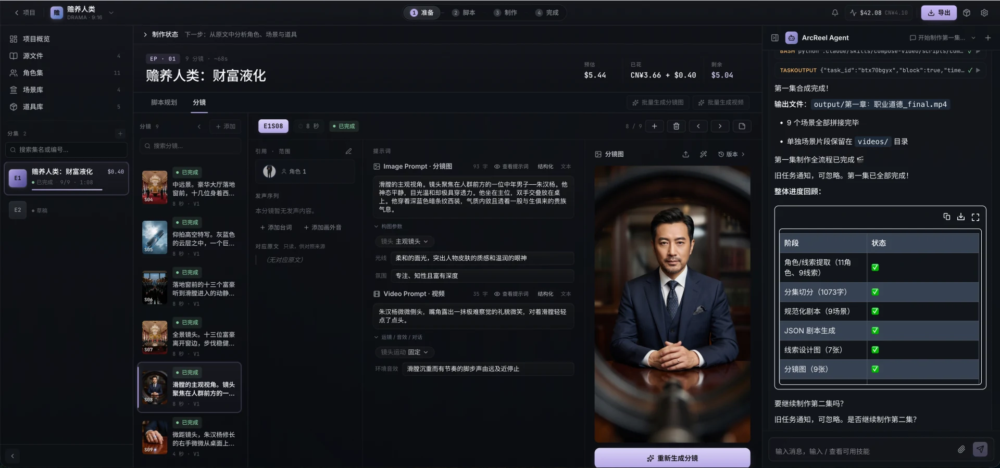
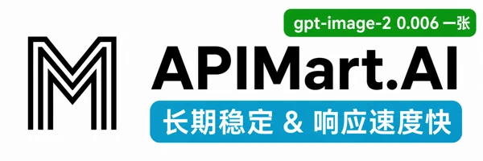
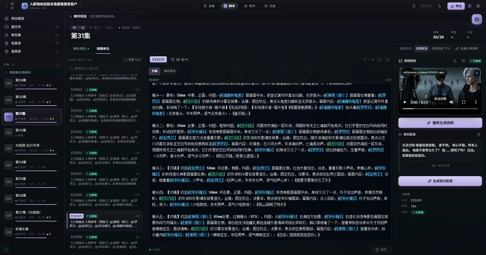
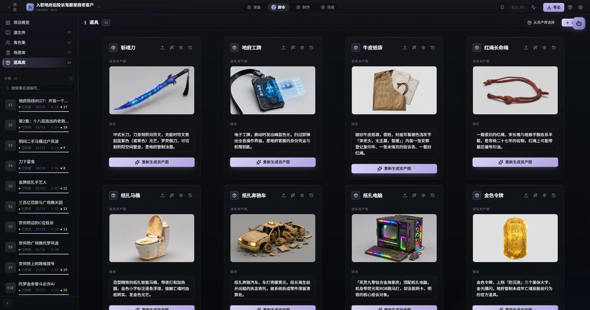
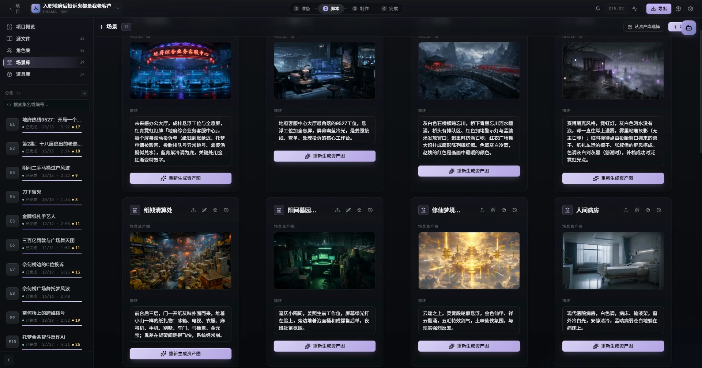
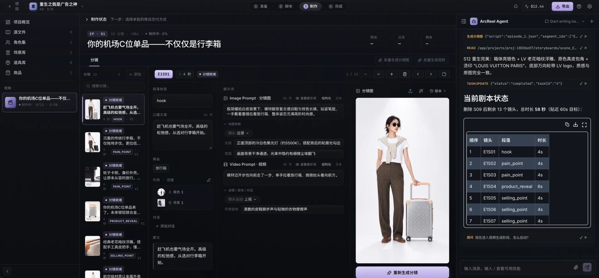
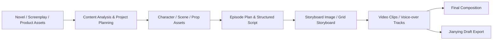

<h1 align="center">
  <br>
  <picture>
    <source media="(prefers-color-scheme: light)" srcset="docs/assets/logo-animated-light.svg">
    <source media="(prefers-color-scheme: dark)" srcset="frontend/public/logo-animated.svg">
    
  </picture>
  <br>
  ArcReel
  <br>
</h1>

<p align="center">
  <strong>オープンソースでセルフホスト型の AI 動画制作ワークスペース</strong>
  <br>
  小説、完成した脚本、商品素材を、キャラクターの一貫性を保ち、制御でき、コストを追跡でき、編集可能なまま残るショート動画に変えます。
</p>

<p align="center">
  <a href="README.md"></a>
  <a href="README.en.md"></a>
  <a href="README.ja.md"></a>
</p>

<p align="center">
  <a href="https://github.com/ArcReel/ArcReel/releases/latest"></a>
  <a href="https://github.com/ArcReel/ArcReel/actions/workflows/test.yml"></a>
  <a href="https://codecov.io/gh/ArcReel/ArcReel"></a>
  <a href="https://hub.docker.com/r/arcreel/arcreel"></a>
  <a href="LICENSE"></a>
  <a href="https://github.com/ArcReel/ArcReel"></a>
</p>

<p align="center">
  <a href="#クイックスタート"><strong>クイックスタート</strong></a>
  ·
  <a href="https://docs.arc-reel.com/en/guide/getting-started">はじめに</a>
  ·
  <a href="https://docs.arc-reel.com/en/">ドキュメント</a>
  ·
  <a href="#コミュニティ">コミュニティ</a>
</p>

<p align="center">
  
</p>

## スポンサー

> [ここに掲載をご希望ですか？](mailto:support@arc-reel.com)

<table>
  <tr>
    <td width="200" align="center" valign="top">
      <a href="https://metaso.cn/minimax-h3/?s=arc"></a>
    </td>
    <td valign="top">
      <strong>MiniMax H3 動画生成 API | Metaso</strong><br>
      Metaso は、コストパフォーマンスに優れた MiniMax H3 の動画生成を提供しています：<strong>768P で 1 秒あたり 0.09 人民元、2K で 1 秒あたり 0.15 人民元</strong>。ネイティブ 2K、音声と映像の同期、<strong>OpenAI プロトコル</strong>互換の API、<strong>ComfyUI</strong> にも対応しており、GPU のデプロイは不要です。<br>
      🎁 <a href="https://metaso.cn/minimax-h3/?s=arc">ArcReel 専用リンクから登録</a>すると、ボーナスクレジットと専用の割引を受けられます。
    </td>
  </tr>
  <tr>
    <td width="200" align="center" valign="top">
      <a href="https://ofox.ai/?utm_source=github&utm_medium=sponsorship&utm_content=arcreel"></a>
    </td>
    <td valign="top">
      <strong>OfoxAI：脚本、画像、動画のためのモデル API</strong><br>
      OfoxAI を通じて、テキスト、画像、動画のモデルにアクセスできます。脚本の推敲、キャラクターやシーンの参照画像の作成、動画素材の生成に合わせて機能を選べます。各モデルの入力要件、対応パラメーター、リクエスト形式については API ドキュメントをご確認ください。<br>
      <a href="https://ofox.ai/?utm_source=github&utm_medium=sponsorship&utm_content=arcreel">OfoxAI のモデルと API を見る →</a>
    </td>
  </tr>
  <tr>
    <td width="200" align="center" valign="top">
      <a href="https://go.apimart.ai/tw-arcreel"></a>
    </td>
    <td valign="top">
      <strong>APIMart：AI 画像・動画生成のための低コスト API</strong><br>
      本プロジェクトをスポンサーしてくださっている APIMart に感謝します！ APIMart は AI 画像・動画生成のための低コストな API プラットフォームです。<strong>GPT-Image-2 は 1 枚 $0.006 から、1 ドルで 160 枚以上</strong>。1 つの非同期 API で画像と動画の両方に対応しています：タスクを送信して ID を受け取り、ポーリングまたはコールバックで結果を取得します。数万枚の画像をタイムアウトなしでバッチ処理でき、コードを変えずにモデルを切り替えられます。月額料金なしの従量課金制です。<a href="https://go.apimart.ai/tw-arcreel">こちらから登録</a>して始めましょう。
    </td>
  </tr>
</table>

## スクリーンショット

<table>
  <tr>
    <td width="50%"></td>
    <td width="50%"></td>
  </tr>
  <tr>
    <td width="50%"></td>
    <td width="50%"></td>
  </tr>
</table>

## ショーケース

<div align="center">
  <video src="https://github.com/user-attachments/assets/fcc4ceb2-64dd-44a0-a32c-e0c00b2f9796" width="100%" controls></video>
</div>

> 《入职地府后投诉鬼都是我老客户》第 1 話

<div align="center">
  <video src="https://github.com/user-attachments/assets/d6bfe589-a5c0-4961-8bfe-b7b59be3bb8a" width="100%" controls></video>
</div>

> 《入职地府后投诉鬼都是我老客户》第 2 話

<div align="center">
  <video src="https://github.com/user-attachments/assets/1e580769-80f7-4d14-b46d-68569b6e7e4c" width="100%" controls></video>
</div>

> 《入职地府后投诉鬼都是我老客户》第 3 話

## ArcReel とは

ArcReel は、AI ドラマや小説の映像化、ナレーション付きショート動画、広告、商品紹介ショートのための、オープンソースでセルフホスト型のワークスペースです。コンテンツ分析、素材管理、絵コンテ、メディア生成、コスト追跡、エクスポートを、確認でき途中から再開できる制作パイプラインにまとめます。

- **1 つの制作ワークフロー**：小説、完成した脚本、商品素材を、キャラクター、シーン、小道具、絵コンテ、動画クリップ、完成動画へと段階的に変えていきます。
- **人がコントロールできる映像の一貫性**：参照素材をショット間で再利用し、主要な段階をレビューし、個々の素材を再生成し、以前のバージョンに戻すことができます。
- **管理しやすいモデルとコスト**：テキスト、画像、動画、TTS の機能を 1 か所で設定し、見積もりコストと実際の使用量を確認できます。
- **編集可能な納品**：完成動画を直接レンダリングするか、剪映（Jianying）の下書きとしてエクスポートして、字幕、ナレーション、テンポ、トランジションを調整できます。エクスポートの対象は中国本土版の剪映で、CapCut との互換性は検証されていません。

## 素材から完成動画まで



すべての段階は Agent に任せることも、ワークスペースでユーザー自身がレビュー、調整、再生成することもできます。モードの選び方については [Workflows and Modes](https://docs.arc-reel.com/en/guide/workflows) をご覧ください。

## クイックスタート

Docker と Docker Compose をインストールしてから、次を実行します：

```bash
git clone https://github.com/ArcReel/ArcReel.git
cd ArcReel/deploy

cp .env.example .env
docker compose up -d
```

<http://localhost:1241> を開きます。デフォルトのユーザー名は `admin` です。`AUTH_PASSWORD` が空の場合、ArcReel は初回起動時にパスワードを生成し、`deploy/.env` に書き戻します。

> デフォルトの Compose は、ホストのすべてのインターフェースでポート `1241` を公開します。ArcReel をそのままパブリックなインターネットに公開しないでください。リモートアクセスを有効にする前に、認証を設定し、HTTPS、VPN、または安全なトンネルを使ってください。[Reverse Proxy and HTTPS](https://docs.arc-reel.com/en/ops/deployment#reverse-proxy-and-https) をご覧ください。

サインインしたら **Settings** を開き、ArcReel Agent と、テキスト、画像、動画などの生成機能を設定してから、プロジェクトを作成します。

初回実行の完全なワークフローについては [Getting Started](https://docs.arc-reel.com/en/guide/getting-started) を、本番環境へのデプロイ、アップグレード、バックアップ、リバースプロキシについては [Deployment and Operations](https://docs.arc-reel.com/en/ops/deployment) をご覧ください。

## ドキュメント

| ページ | 内容 |
|---|---|
| [Documentation Home](https://docs.arc-reel.com/en/) | ユーザー、運用担当者、開発者向けの入口 |
| [Getting Started](https://docs.arc-reel.com/en/guide/getting-started) | 最初のデプロイから最初の動画生成まで |
| [Workflows and Modes](https://docs.arc-reel.com/en/guide/workflows) | 小説、脚本、創作アイデア。3 つの制作タイプと 2 つの生成モード |
| [Provider Configuration](https://docs.arc-reel.com/en/guide/providers) | Agent、テキスト、画像、動画、TTS の各プロバイダーの選択と設定 |
| [Jianying Draft Export](https://docs.arc-reel.com/en/guide/jianying-export) | ArcReel の出力を剪映で引き続き編集する |
| [FAQ](https://docs.arc-reel.com/en/guide/faq) | デプロイ、コスト、モデル、データ、ライセンスに関する質問 |
| [Deployment and Operations](https://docs.arc-reel.com/en/ops/deployment) | SQLite、PostgreSQL、アップグレード、バックアップ、リバースプロキシ |
| [Migrate from SQLite to PostgreSQL](https://docs.arc-reel.com/en/ops/migrate-to-postgres) | データの移行、検証、ロールバック |
| [Architecture](https://docs.arc-reel.com/en/dev/architecture) | Agent Runtime、タスクキュー、プロバイダーの抽象化、データ層 |
| [Contributing](https://docs.arc-reel.com/en/dev/contributing) | ローカル開発、テスト、規約、プルリクエスト |

## コミュニティ

QR コードを読み取って ArcReel の Feishu コミュニティに参加すると、質問への回答、リリース情報、ワークフローに関する議論を得られます：

<p align="center">
  
</p>

再現可能なバグや、焦点を絞った機能リクエストは [GitHub Issues](https://github.com/ArcReel/ArcReel/issues) で受け付けています。

## コントリビューション

コード、ドキュメント、テスト、プロバイダーアダプター、再現可能なバグ報告へのコントリビューションを歓迎します。

始める前に [CONTRIBUTING.md](CONTRIBUTING.md) をお読みください。リポジトリをクローンしたら、pre-commit フックをインストールします：

```bash
uv run pre-commit install
```

## Star の推移

<a href="https://www.star-history.com/?repos=arcreel%2Farcreel&type=date&legend=top-left">
 <picture>
   <source media="(prefers-color-scheme: dark)" srcset="https://api.star-history.com/chart?repos=arcreel/arcreel&type=date&theme=dark&legend=top-left" />
   <source media="(prefers-color-scheme: light)" srcset="https://api.star-history.com/chart?repos=arcreel/arcreel&type=date&legend=top-left" />
   
 </picture>
</a>

## ライセンスと商用利用

ArcReel は [GNU Affero General Public License v3.0](LICENSE) のもとでライセンスされています。追加の条項は [NOTICE](NOTICE) にあります。

AGPL-3.0 を利用できない組織や、AGPL の義務を負わない商用デプロイ、ホワイトラベル、再配布が必要な場合は、こちらにご連絡ください：

**support@arc-reel.com**

Copyright © 2026 Pollo3470 and ArcReel contributors

---

<p align="center">
  ArcReel がお役に立ったら、プロジェクトに ⭐ Star を付けていただけると嬉しいです。
</p>
