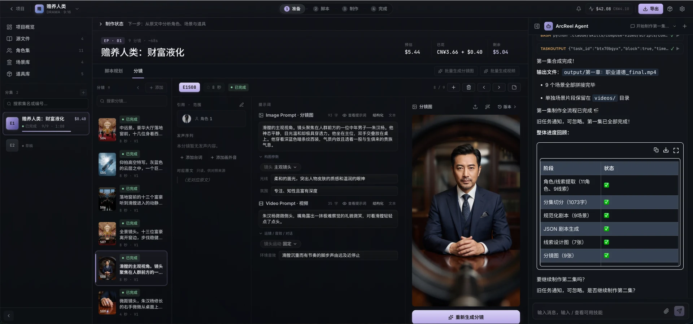
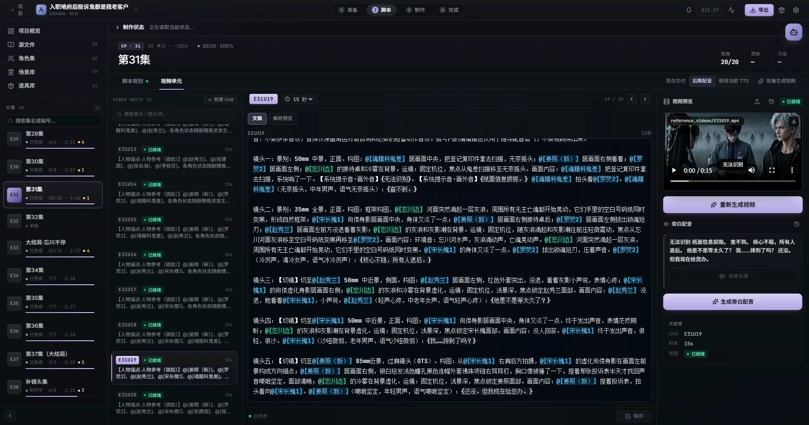
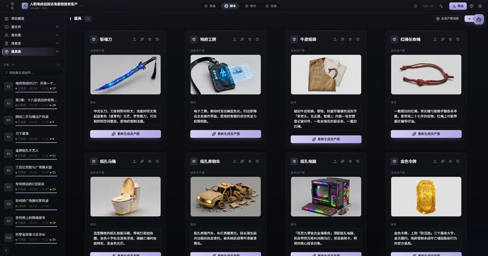
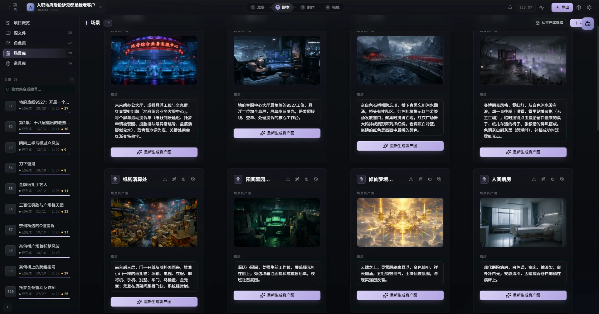
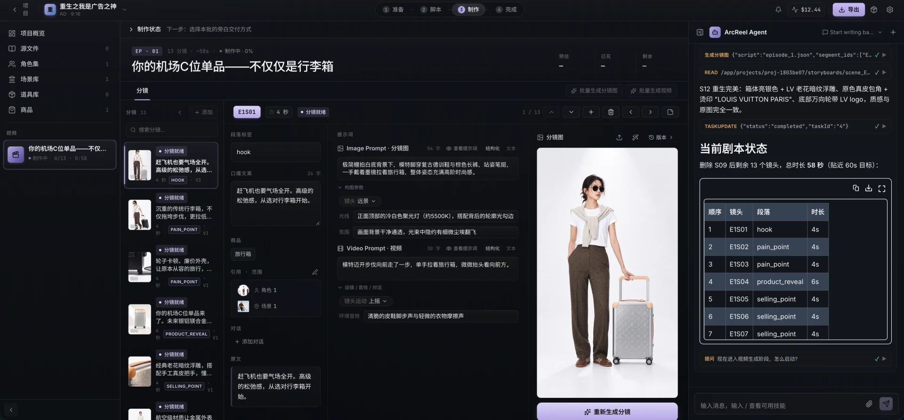

<h1 align="center">
  <br>
  <picture>
    <source media="(prefers-color-scheme: light)" srcset="docs/assets/logo-animated-light.svg">
    <source media="(prefers-color-scheme: dark)" srcset="frontend/public/logo-animated.svg">
    
  </picture>
  <br>
  ArcReel
  <br>
</h1>

<p align="center">
  <strong>开源、自托管的 AI 视频生产工作台</strong>
  <br>
  将小说、成品剧本或商品素材转化为角色一致、过程可控、成本可追踪且可继续编辑的短视频。
</p>

<p align="center">
  <a href="README.md"></a>
  <a href="README.en.md"></a>
</p>

<p align="center">
  <a href="https://github.com/ArcReel/ArcReel/releases/latest"></a>
  <a href="https://github.com/ArcReel/ArcReel/actions/workflows/test.yml"></a>
  <a href="https://codecov.io/gh/ArcReel/ArcReel"></a>
  <a href="https://hub.docker.com/r/arcreel/arcreel"></a>
  <a href="LICENSE"></a>
  <a href="https://github.com/ArcReel/ArcReel"></a>
</p>

<p align="center">
  <a href="#快速开始"><strong>快速开始</strong></a>
  ·
  <a href="https://docs.arc-reel.com/guide/getting-started">入门教程</a>
  ·
  <a href="https://docs.arc-reel.com/">完整文档</a>
  ·
  <a href="#交流群">加入社区</a>
</p>

<p align="center">
  
</p>

## 赞助商

> [想出现在这里？](mailto:support@arc-reel.com)

<table>
  <tr>
    <td width="200" align="center" valign="top">
      <a href="https://metaso.cn/minimax-h3/?s=arc"></a>
    </td>
    <td valign="top">
      <strong>MiniMax H3 视频生成 API｜秘塔科技</strong><br>
      秘塔科技提供高性价比的 MiniMax H3 视频生成服务：<strong>768P 仅 0.09 元/秒，2K 仅 0.15 元/秒</strong>。支持原生 2K、音画同步，API 兼容 <strong>OpenAI 协议</strong>，同时支持 <strong>ComfyUI</strong>，无需自行部署 GPU。<br>
      🎁 通过 <a href="https://metaso.cn/minimax-h3/?s=arc">ArcReel 专属链接注册</a>，即可领取赠送额度及专属优惠。
    </td>
  </tr>
  <tr>
    <td width="200" align="center" valign="top">
      <a href="https://ofox.ai/?utm_source=github&utm_medium=sponsorship&utm_content=arcreel"></a>
    </td>
    <td valign="top">
      <strong>OfoxAI：脚本、图像与视频创作的模型 API</strong><br>
      通过 OfoxAI 接入文本、图像和视频模型，为脚本打磨、角色与场景参考图、视频镜头素材选择合适的能力。具体模型的输入要求、支持参数及调用方式请查看 API 文档。<br>
      <a href="https://ofox.ai/?utm_source=github&utm_medium=sponsorship&utm_content=arcreel">探索 OfoxAI 模型与 API →</a>
    </td>
  </tr>
  <tr>
    <td width="200" align="center" valign="top">
      <a href="https://go.apimart.ai/tw-arcreel"></a>
    </td>
    <td valign="top">
      <strong>APIMart：AI 图片/视频生成低价 API</strong><br>
      感谢 APIMart 赞助了本项目！APIMart 是专注 AI 图片/视频生成的低价 API 平台，<strong>GPT-Image-2 低至 $0.006/张，1 美元可出图 160+ 张</strong>。图片、视频一套异步 API 通吃，提交任务拿 ID、回调取结果，跑批万张不超时、换模型不改代码。按量付费、无月费，通过<a href="https://go.apimart.ai/tw-arcreel">此注册链接</a>注册即可开用。
    </td>
  </tr>
</table>

## 界面一览

<table>
  <tr>
    <td width="50%"></td>
    <td width="50%"></td>
  </tr>
  <tr>
    <td width="50%"></td>
    <td width="50%"></td>
  </tr>
</table>

## 案例

<div align="center">
  <video src="https://github.com/user-attachments/assets/fcc4ceb2-64dd-44a0-a32c-e0c00b2f9796" width="100%" controls></video>
</div>

> 《入职地府后投诉鬼都是我老客户》第 1 集

<div align="center">
  <video src="https://github.com/user-attachments/assets/d6bfe589-a5c0-4961-8bfe-b7b59be3bb8a" width="100%" controls></video>
</div>

> 《入职地府后投诉鬼都是我老客户》第 2 集

<div align="center">
  <video src="https://github.com/user-attachments/assets/1e580769-80f7-4d14-b46d-68569b6e7e4c" width="100%" controls></video>
</div>

> 《入职地府后投诉鬼都是我老客户》第 3 集

## ArcReel 是什么

ArcReel 支持旁白/解说、剧情演绎和广告/短片。创作者可以让 Agent 编排制作，也可以在工作台审核、修改或重新生成各阶段的内容。

- 跨镜头复用角色、场景和道具的参考素材，保留生成历史以便对比与回滚。
- 按项目配置文本、图像、视频和配音能力，查看生成前的费用预估与调用后的实际用量。
- 合成可播放的视频，或导出草稿交给中国大陆版剪映继续编辑。CapCut 兼容性尚未验证。

## 从输入到成片

旁白/解说和剧情演绎项目先确认脚本规划。广告/短片项目直接生成正式脚本。分镜图生视频用分镜图作起始画面。参考生视频用视频单元和参考素材生成镜头。视频和音频剪辑后，可以输出成片或剪映草稿。创作类型、生成模式和内容确认见[创作流程与模式](https://docs.arc-reel.com/guide/workflows)。

## 快速开始

准备好 Docker 和 Docker Compose 后，执行以下命令：

```bash
git clone https://github.com/ArcReel/ArcReel.git
cd ArcReel/deploy

cp .env.example .env
docker compose up -d
```

打开浏览器访问 <http://localhost:1241>，使用默认用户名 `admin` 登录。如果 `AUTH_PASSWORD` 留空，首次启动时会自动生成随机密码并写回 `deploy/.env`。

> 默认的 Compose 配置会将 `1241` 端口发布到宿主机的所有网络接口。如需远程访问，请先配置认证，并通过 HTTPS 反向代理、VPN 或安全隧道接入。详见[反向代理与 HTTPS](https://docs.arc-reel.com/ops/deployment#reverse-proxy-and-https)。

登录后进入 **设置** 页面，配置 ArcReel Agent 以及文本、图像、视频等生成能力，随后即可创建项目开始制作。

完整的首次使用流程见 [完整入门教程](https://docs.arc-reel.com/guide/getting-started)；生产部署、升级、备份和反向代理见 [部署与运维](https://docs.arc-reel.com/ops/deployment)。

## 文档

- [入门教程](https://docs.arc-reel.com/guide/getting-started)和[文档首页](https://docs.arc-reel.com/)提供创作说明和主题索引。
- [部署与运维](https://docs.arc-reel.com/ops/deployment)说明部署、升级与备份。
- [贡献指南](CONTRIBUTING.md)和[架构说明](https://docs.arc-reel.com/dev/architecture)面向开发者。

## 交流群

扫码加入飞书交流群，获取使用帮助、版本动态和创作经验：

<p align="center">
  
</p>

遇到可复现的 Bug 或明确的功能需求，也可以直接提交 [GitHub Issue](https://github.com/ArcReel/ArcReel/issues)。

## 贡献

欢迎贡献代码、文档、测试、供应商适配和问题复现。

本地开发环境、测试方法与提交流程请见[贡献指南](CONTRIBUTING.md)。

## Star History

<a href="https://www.star-history.com/?repos=arcreel%2Farcreel&type=date&legend=top-left">
 <picture>
   <source media="(prefers-color-scheme: dark)" srcset="https://api.star-history.com/chart?repos=arcreel/arcreel&type=date&theme=dark&legend=top-left" />
   <source media="(prefers-color-scheme: light)" srcset="https://api.star-history.com/chart?repos=arcreel/arcreel&type=date&legend=top-left" />
   
 </picture>
</a>

## 许可证与商业使用

ArcReel 采用 [GNU Affero General Public License v3.0](LICENSE)，附加条款见 [NOTICE](NOTICE)。

如果你的组织无法采用 AGPL-3.0，或者希望在不承担 AGPL 开源义务的情况下进行商业部署、白标或再分发，请联系：

**support@arc-reel.com**

Copyright © 2026 Pollo3470 and ArcReel contributors

---

<p align="center">
  如果 ArcReel 对你有帮助，欢迎点亮一个 ⭐ Star。
</p>
