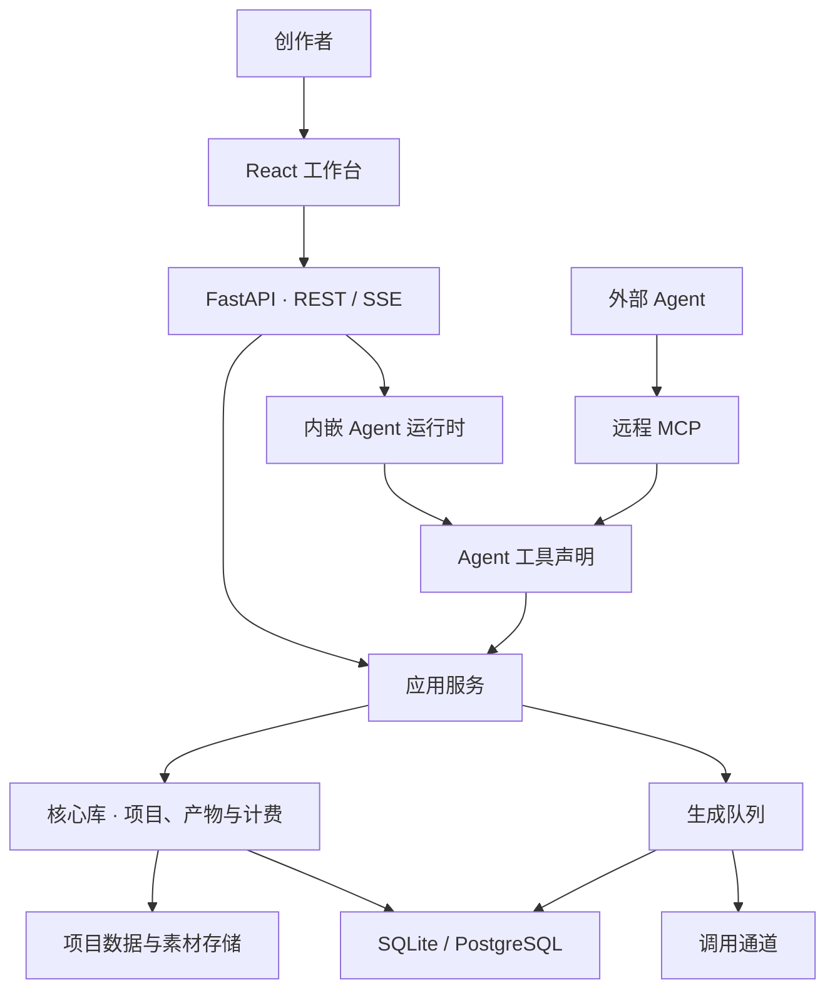

# 架构说明 {#architecture}

本文面向 ArcReel 贡献者，介绍系统的模块边界、数据流向与扩展入口。本地开发环境搭建与测试步骤见[贡献指南](./contributing.md)。

## 系统边界 {#overview}

ArcReel 将素材、脚本、生成和剪辑组织成一条可审核的创作流程，每个阶段都保留可继续编辑的结果；外部生成的供应商、计费与失败恢复则独立于创作流程之外。

| 层 | 入口与职责 |
| --- | --- |
| `frontend/` | React 工作台，通过 REST 读写项目与配置，通过 SSE 接收对话消息及项目变更通知。 |
| `server/` | 装配 HTTP 服务、内嵌 Agent 与远程 MCP，并协调跨领域的业务用例。 |
| `lib/` | 承载项目、产物与任务等领域规则，并提供数据库、素材存储及供应商调用等基础设施能力。 |

### 核心库与服务端的分界 {#core-server-boundary}

依赖方向由 `server/` 指向 `lib/`：领域逻辑和基础设施留在核心库，HTTP 路由、SDK、SSE 和用例编排留在服务端。简单路由可直接调用核心库，多入口共用或需要协调事务与补偿的用例则由应用服务承接。`pyproject.toml` 的 import-linter 契约检查这条依赖方向以及核心库与 HTTP 框架的隔离。

## 工作台与 API {#frontend-layer}

`server/routers/` 提供项目、任务与设置相关的 HTTP 入口。对话 SSE 用于流式返回 Agent 回复，项目事件 SSE 用于通知工作台重新拉取项目数据；任务查询接口则提供执行进度，并支持断线重连后恢复展示。代理配置详见[反向代理与 HTTPS](../ops/deployment.md#reverse-proxy-and-https)。

`frontend/src/components` 按页面和工作区组织界面组件，`frontend/src/stores` 维护跨界面的共享状态。任务与产物的状态统一由后端判定。具体的布局、保存与刷新规则见[前端规范](https://github.com/ArcReel/ArcReel/blob/main/docs/standards/frontend.md)。

| 改动对象 | 入口 |
| --- | --- |
| 页面布局和滚动 | `components/shared/page-shell`、`components/shared/master-detail` 与 `components/layout/StudioLayout.tsx` |
| 设置页深链和返回目标 | `frontend/src/app-routes.ts` 与 `components/shared/page-shell/return-to.ts` |
| 项目刷新和配置问题 | `frontend/src/stores/projects-store.ts` 负责合并刷新，写入操作后通过 `components/canvas/shared/refreshAfterWrite.ts` 触发刷新；`frontend/src/stores/config-status-store.ts` 按设置分区提供配置问题状态。 |

### 编辑单元与离开拦截 {#edit-unit-and-leave-guard}

`components/shared/edit-unit/useEditUnit` 管理已保存内容、未保存修改和保存结果。离开页面时由 `LeaveGuardProvider` 统一处理未保存修改，即时操作独立于编辑单元的保存。

表单的保存栏置于页面外壳或详情栏的底部，画布的未保存修改提示置于所属内容下方。

## Agent Runtime {#agent-runtime}

内嵌 Agent 由 `server/agent_runtime/` 封装 Claude Agent SDK。主 Agent 负责和创作者交互，并通过工作流 Skill、子智能体和工具推进项目。

| 职责 | 入口 |
| --- | --- |
| 选择下一步、协调操作、等待确认 | `agent_runtime_profile/.claude/skills/` 中的工作流 Skill 根据当前项目状态推进流程。 |
| 分析长文本、拆分单元、审阅素材 | `agent_runtime_profile/.claude/agents/` 中的子智能体接收子任务，返回摘要与结果引用。 |
| 读写项目、提交任务与导出 | `server/agent_toolset/` 统一声明工具契约，内嵌 Agent 与远程 MCP 均从同一份声明注册工具。 [ADR 0087](https://github.com/ArcReel/ArcReel/blob/main/docs/adr/0087-agent-toolset-single-declaration.md) |
| 串行处理会话操作 | `server/agent_runtime/session_actor.py` 独占会话的 SDK client，通过命令队列串行处理对话、打断与断开操作。 [ADR 0028](https://github.com/ArcReel/ArcReel/blob/main/docs/adr/0028-session-actor-single-task-serialization.md) |

`agent_runtime_profile/` 统一管理创作 Agent 的 Skill、子智能体以及各创作类型的 `CLAUDE.*.md`。`lib/agent/profile_manifest.py` 负责将这些配置物化到具体项目中，并识别项目侧的自定义修改。若要调整随版本交付的默认创作行为，请直接从配置源修改。

## 项目数据与素材 {#project-and-asset-model}

每个项目目录中都包含 `project.json`，以及源文件、脚本、版本记录和各类产物。`lib/infra/data_root_layout.py` 定义了数据根目录下项目、全局资产库、用户记忆等数据的存放路径。备份与恢复范围见[部署与运维](../ops/deployment.md)。

项目引用素材身份，实际字节由素材存储保管；供应商素材关联则属于具体内容版本。因此，仅改变存储位置时，内容身份和产物时效都会保持不变。参见 [ADR 0108](https://github.com/ArcReel/ArcReel/blob/main/docs/adr/0108-material-storage-independent-of-provider-registration.md) 与 [ADR 0119](https://github.com/ArcReel/ArcReel/blob/main/docs/adr/0119-archives-carry-content-not-storage-locators.md)。

`lib/db/` 基于 SQLAlchemy 异步 ORM 保存运行时状态（如账号、凭证与任务），服务启动时会通过 Alembic 自动执行数据库升级。配置与迁移指引见[部署与运维](../ops/deployment.md)和[数据库迁移指南](../ops/migrate-to-postgres.md)。

`lib/artifacts/` 管理版本记录、当前版本和产物登记。生成或导入的新版本可与历史版本比较，重新选择历史版本会更新当前内容。产物时效根据登记的生成依据判定。参见 [ADR 0062](https://github.com/ArcReel/ArcReel/blob/main/docs/adr/0062-artifact-lifecycle-and-currency.md)。

## 请求、任务与费用 {#generation-queue}

`lib/generation/` 负责持久化生成任务并调度执行。生成 Worker 按供应商与媒体类型分配并发容量，本地渲染则独占一条执行车道。任务进入终态后会驱动项目状态同步更新。

任务标识用于串联执行结果与费用记录。续跑视频任务时，会依据提交时锁定的调用上下文查询原任务，避免重复提交和二次扣费。参见 [ADR 0055](https://github.com/ArcReel/ArcReel/blob/main/docs/adr/0055-generation-route-locked-at-creation.md) 与[供应商规范](https://github.com/ArcReel/ArcReel/blob/main/docs/standards/providers.md)。

### 供应商抽象 {#provider-abstraction}

`lib/backends/` 定义文本、图像、视频和音频的调用协议及装配逻辑。供应商模型将 API 模型名与调用端点组合起来。模型条目保存模型自身的事实与价目表，端点或调用通道声明协议与执行事实，渠道差异由适用的能力覆盖表达。由能力求值统一决定可用输入与限制。参见 [ADR 0099](https://github.com/ArcReel/ArcReel/blob/main/docs/adr/0099-model-catalog-shared-entries-per-model.md) 与 [ADR 0104](https://github.com/ArcReel/ArcReel/blob/main/docs/adr/0104-capability-sources-split-by-dimension.md)。

调用链路入口与上游文档来源见[供应商 API 索引](https://github.com/ArcReel/ArcReel/tree/main/docs/api-docs)，用户侧配置方式见[供应商与模型配置](../guide/providers.md)。

### 取消与中断的来源 {#cancellation-sources}

创作者可以取消排队中的生成任务；客户端断开时在途任务继续执行。服务收到停机信号后，立即关闭新任务领取与重试下载准入，主动结束项目事件流与 Agent 会话流等活跃 SSE 连接（前端随后自动重连并同步状态，远程 MCP 流式连接随同一停机周期退出），再在停机宽限期内并行等待在途生成任务完成与常驻 Agent 会话优雅退出。

在途生成任务可能因超时或进程在宽限期外终止而中断。服务停机时不主动取消超时的在途任务；重启后，仍处于运行中、已记录供应商任务号、执行检查点有效且调用通道支持续查的视频任务会自动继续轮询并取回原结果，其余中断的在途任务则标记为失败，由创作者决定是否重试。恢复实现见 `lib/generation/restart_recovery.py`，线程写入和落账的取消约束见[后端规范](https://github.com/ArcReel/ArcReel/blob/main/docs/standards/backend.md)。测试连接与 Agent 会话另有各自的取消入口。参见 [ADR 0006](https://github.com/ArcReel/ArcReel/blob/main/docs/adr/0006-cancel-only-queued-tasks.md)、[ADR 0007](https://github.com/ArcReel/ArcReel/blob/main/docs/adr/0007-orphan-tasks-not-requeued-on-restart.md) 与 [ADR 0046](https://github.com/ArcReel/ArcReel/blob/main/docs/adr/0046-session-manager-decomposition-boundaries.md)。

### 用量和费用 {#usage-and-cost}

调用通道按供应商的实际请求报告用量。`lib/billing/` 根据模型目录的价目表计算费用，完成调用时将费用与用量记入账本，历史费用以当时的记录为准。无法确定价格的用量会标记为未定价，不同币种分别统计。参见 [ADR 0076](https://github.com/ArcReel/ArcReel/blob/main/docs/adr/0076-usage-record-is-projection-of-provider-calls.md) 与 [ADR 0100](https://github.com/ArcReel/ArcReel/blob/main/docs/adr/0100-price-table-meters-and-dimensions.md)。

## 剪辑、成片与导出 {#video-composition-and-export}

每集可以维护多条具名剪辑时间线。`lib/edit_timeline/` 负责管理时间线修订与 BGM 编排，其中的片段始终引用视频单元的当前内容。预览与导出均通过 `server/services/presentation/` 共享同一套素材版本、实测时长、音频与字幕时序。参见 [ADR 0090](https://github.com/ArcReel/ArcReel/blob/main/docs/adr/0090-edit-timeline-named-follows-current-not-artifact.md)。

`lib/final_cut/` 基于随包分发的 FFmpeg 渲染成片，`lib/jianying_draft/` 则负责构建可继续编辑的剪映草稿。渲染与导出均在本地车道中执行，产物时效取决于所用时间线修订与素材版本。参见 [ADR 0095](https://github.com/ArcReel/ArcReel/blob/main/docs/adr/0095-final-cut-rendered-locally-with-bundled-ffmpeg.md) 与[剪映草稿导出](../guide/jianying-export.md)。

Agent 可用 `inspect_images` 和 `inspect_video_units` 只读审阅选定的素材版本。视频联系表和机器检测信号供审阅参考。

## 访问控制与沙箱 {#sandbox-and-security}

工作台以用户名与密码登录并取得 JWT。外部 Agent 使用可撤销的 `arc-` 访问令牌，通过 `/mcp` 调用工具。创建时返回完整令牌，服务端保存其哈希。设置页提供指向当前实例 `/agent-installation-guide.md` 的接入指引。参见 [ADR 0065](https://github.com/ArcReel/ArcReel/blob/main/docs/adr/0065-remote-mcp-trusts-existing-api-keys.md)。

`server/agent_runtime/agent_access_policy.py` 统一定义内嵌 Agent 的访问策略，投影到操作系统沙箱和 SDK 工具钩子。Linux 与 macOS 在沙箱不可用时拒绝启动，Windows 原生环境用 Bash 命令前缀白名单降级。安全保证与限制见[威胁模型](https://github.com/ArcReel/ArcReel/blob/main/docs/security/threat-model.md)与[部署与运维](../ops/deployment.md)。

## 扩展入口 {#related-docs}

着手改动前，请先确认当前的[领域用语](https://github.com/ArcReel/ArcReel/blob/main/GLOSSARY.md)与[架构决策](https://github.com/ArcReel/ArcReel/tree/main/docs/adr)，并对照[代码规范](https://github.com/ArcReel/ArcReel/blob/main/CODING_STANDARDS.md)核对改动涉及的边界。

### 添加供应商 {#extend-provider}

1. 先从[供应商 API 索引](https://github.com/ArcReel/ArcReel/tree/main/docs/api-docs)定位官方协议文档与现有调用入口。
2. 在调用端点或调用通道中实现鉴权、请求构造、结果解析与错误处理；若是异步调用，还需同步验证超时、轮询与续跑语义。
3. 在目录数据仓库中维护官方模型、能力声明与定价信息，发版流程会自动更新随版本分发的模型目录快照。参见 [ADR 0103](https://github.com/ArcReel/ArcReel/blob/main/docs/adr/0103-catalog-data-repo-built-from-third-party-sources.md)。
4. 按照[供应商规范](https://github.com/ArcReel/ArcReel/blob/main/docs/standards/providers.md)逐项验证入口、请求、用量上报与失败路径，并同步更新面向用户的配置指引。

### 添加工作流阶段 {#extend-workflow-stage}

先定义可从项目状态核验的输入、完成条件和产物。确定人工确认、计费准入、失败恢复和版本语义后，在核心库实现规则，由服务层提供用例，再接入工作流 Skill 或界面。沿[创作流程](../guide/workflows.md)验证创作者能看到阶段状态并继续下一步。
