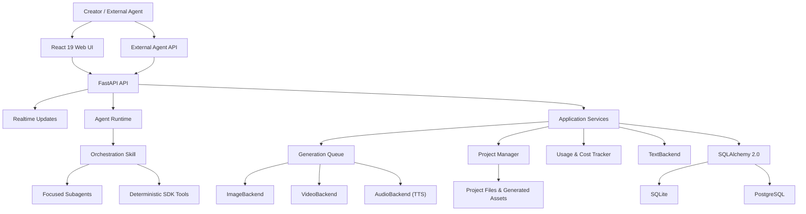
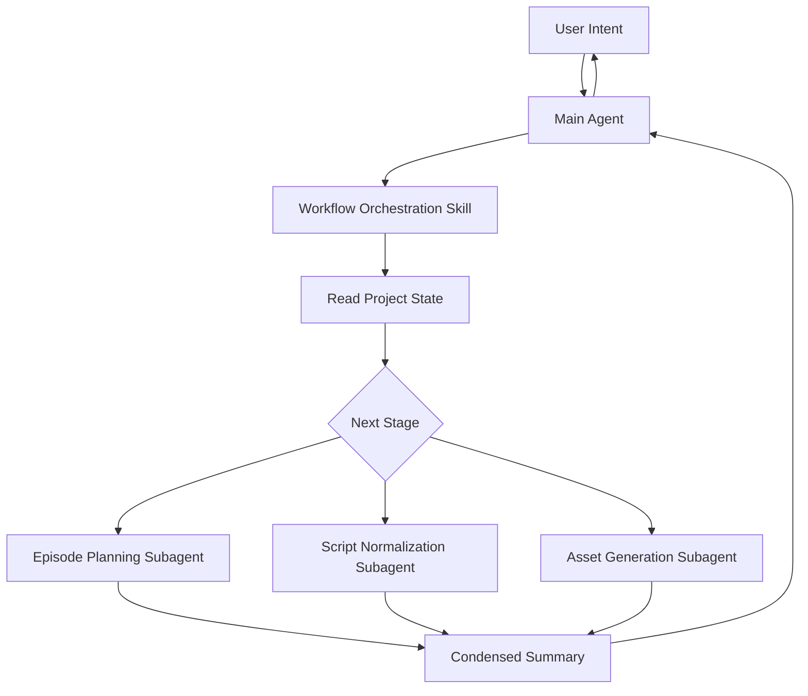
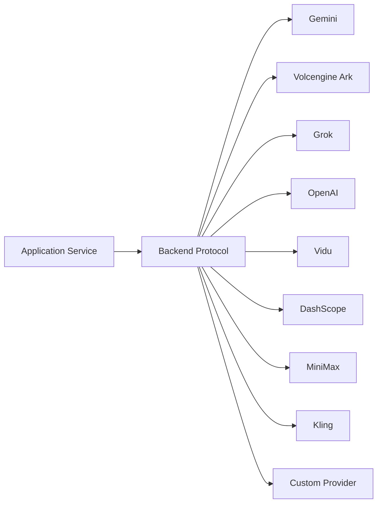

# Architecture {#architecture}

This document describes ArcReel's stable architectural boundaries, primary data flows, and extension points. It does not replace code-level API documentation or record temporary implementation plans.

## 1. Architecture Goals {#goals}

ArcReel's core goal is not to tie the product to any particular model, but to provide an AI video production pipeline that is:

- orchestratable;
- reviewable;
- resumable after interruption;
- provider-agnostic;
- cost-trackable;
- version-preserving;
- ready for continued post-production editing.

## 2. Overall Architecture {#overview}



## 3. Frontend Layer {#frontend-layer}

The frontend uses React 19 and TypeScript. Its primary responsibilities include:

- project listing and creation;
- the project workbench;
- asset previews;
- conversations with the AI assistant;
- task status;
- usage and spend statistics;
- settings and provider management;
- version history;
- project import and export.

The frontend must not handle provider credentials directly or bypass the backend to call models.

### 3.1 Page Shell and Tiers {#page-shell}

Page-level views such as Global Settings, Project Settings, the project lobby, and the asset library are composed by `PageShell` from `components/shared/page-shell`: `PageHeader` is the top bar, with "Back | Title | Subtitle" on the left and page-level actions on the right; `PageSidebar` is the grouped navigation docked on the left. The shell is the only place that switches tiers by viewport: at the `xl` boundary it adjusts the sidebar width and content padding between the standard and compact tiers. The content column is a size container named `page`, and sections respond to width with container queries such as `@md/page:`; ESLint's `RESTRICT_VIEWPORT_BREAKPOINT` blocks viewport breakpoint prefixes in business components.

The shell's `tier` is chosen by content, and different sections of the same page may use different tiers:

- `constrained`: the content column has a maximum width and sits flush against the sidebar; the shell body scrolls and provides padding. Used for forms and settings.
- `full`: no maximum width; otherwise the same as constrained. Used for lists, grids, and tables.
- `bleed`: the shell body neither scrolls nor adds padding; the section fills the remaining height, lays out its own columns, and each column scrolls independently. Used for master-detail layouts and editors.

The tier provides the page-level maximum width, centering, and outer padding, so sections do not write their own `max-w-*`, `mx-auto`, or outer padding.

Where the save bar goes depends on the tier. The constrained and full tiers have a fixed footer row below the shell body that covers only the content area and does not scroll with the body; a section renders its save bar into it with `<PageShellFooter><SaveBar unit={unit} /></PageShellFooter>`, and the row is hidden when the section renders no save bar. The bleed tier has no such row: the save bar sits at the bottom of the section's detail pane, outside the scroll area.

Bleed "list + detail" sections (such as providers, endpoints, and Agent memory) use `components/shared/master-detail`: `SecondaryRail` on the left lists entries by `groups`, and selection goes through each entry's `href` route; `DetailPane` on the right has header, body, and footer parts, only the body scrolls, and the `SaveBar` of a settings detail goes into the footer. When the selected item changes, pass a `key` to the detail component so the whole pane is rebuilt and the previous item's unsaved changes, in-flight requests, and loading state do not carry over. When a constrained page has no room for a secondary rail (such as "Project Memory" in Project Settings), use `SecondaryRailList` to list the same group of entries on its own. See each component's TSDoc for its props and form switching.

### 3.2 Project Workspace Layout {#studio-layout}

The project workspace is composed by `components/layout/StudioLayout`: a top bar spans the full width, with three columns below it, "sidebar | canvas | Agent panel". The handles between columns can be dragged or adjusted with the arrow keys. The shell switches tiers at the `xl` boundary: in the standard tier the Agent panel squeezes the canvas; in the compact tier the Agent panel overlays the right side of the canvas and the sidebar collapses to an icon rail. The canvas `main` is a width container named `canvas`, and views inside the canvas respond to width with container queries such as `@md/canvas:`. The Agent panel is a size container named `agent`, so height limits set in `cqh` inside the panel are computed from the panel height. The shell has no entry points floating over the canvas, and elements in the canvas do not reserve right-side space for the Agent panel.

The Agent panel's open state lives in `useAppStore`. Opening the panel programmatically (for example, when prefilling an instruction into the input) calls `setAssistantPanelOpen(true)`, which affects only the current session and is not remembered; only the top-bar "Agent" toggle and drag-to-collapse remember the user's choice through `toggleAssistantPanel`. Content stays mounted while the panel is collapsed, so prefilled input is not lost.

### 3.3 Frontend Routing and Deep Links {#frontend-routing}

The page "Back" behavior comes from `components/shared/page-shell/return-to.ts`. `useTrackReturnTo` at the router root records the most recently visited app page (including the query string) in `sessionStorage`; moving between Global Settings and the asset library does not change the return target, and redirect-only entries are not recorded. A "Back" button calls the callback returned by `useReturnTo()` to go back to the page visited before; when nothing is recorded it goes to the project lobby. Entry buttons and deep links therefore do not record their own origin. `useReturnTo` is only for pages on top-level routes: `navigate` inside a nested route resolves against the nested path.

Links to a Global Settings section are generated with `settingsSectionPath(section, params)` from `app-routes.ts`. The section name is checked by the `SettingsSection` type, so renaming a section makes typecheck report every stale link. When navigating from inside a nested route, prefix the path with `~`, for example `` `~${settingsSectionPath("usage")}` ``.

Navigation between providers and endpoints uses `providerSettingsPath(target)` and `endpointSettingsPath(endpointKey, { fromCustomProvider })` instead of hand-built query parameters. When jumping from a custom provider to an endpoint, pass `fromCustomProvider`, and the endpoint page shows a link back to that provider at the top. See each function's TSDoc for how it maps to query parameters.

### 3.4 Project Data Refresh {#project-data-refresh}

Project data refresh converges on `refreshProject` in `frontend/src/stores/projects-store.ts`. Edit writes, project event SSE, route loading, and other entry points all call this one action, which coalesces in-flight work internally: while a refresh is in flight, new calls queue and one more round runs after it finishes, and each caller receives its own settled result; when a queued target project is superseded by another project, the superseded caller settles immediately as `cancelled` and does not share the new project's result. When adding data that needs refreshing from multiple entry points, follow the same structure instead of letting each caller send its own request; otherwise concurrent refreshes interleave their write-backs. Use a store action to coalesce multi-entry refreshes and an AbortSignal to cancel loading of a piece of data; the two complement each other.

Every refresh after a successful write goes through `frontend/src/components/canvas/shared/refreshAfterWrite`. `refreshProject` reports failure through its settled result instead of rejecting; when a write has committed but the refresh fails, the UI stays on stale data, looks as if the write did not take effect, and creators tend to repeat the operation. `refreshAfterWrite` shows `common:write_refresh_failed` when the result is `failed`, stays silent on `cancelled` (the project has been switched away), and returns the settled result unchanged so callers can decide on follow-up actions that depend on the new data; the review rule for those follow-ups is in the [frontend standards](https://github.com/ArcReel/ArcReel/blob/main/docs/standards/frontend.md) under "依赖新数据的后续动作只在刷新结算为 `success` 后提供" (a follow-up action that depends on the new data is offered only after the refresh settles as `success`), and the call sites that may skip it are listed in its TSDoc. Load and sync paths such as the first route load and project event SSE are not post-write refreshes; they should pass `onError` or handle the settled result. ESLint's `RESTRICT_DISCARDED_REFRESH` blocks calls that discard the settled result without passing `onError`. Reference: `frontend/src/components/canvas/episodes/CreateEpisodeDialog.tsx` (navigates to the new episode only after the refresh succeeds).

### 3.5 Edit Units and the Leave Guard {#edit-unit-and-leave-guard}

A settings view or a block of canvas content is one [edit unit](https://github.com/ArcReel/ArcReel/blob/main/GLOSSARY.md), and `components/shared/edit-unit/useEditUnit` holds its saved content and unsaved changes. Fields (descriptions, prompts, durations, references, and toggles and selects in settings forms) are written through `unit.setValue` and saved or discarded together by the unit; actions such as upload, generate, rename, delete, and reorder do not enter unsaved changes and run immediately.

- Saved content comes in through `source`, both the load result and later pushes, instead of an effect that resets local state to server data. Without unsaved changes the hook adopts the new content directly; with changes it keeps them and marks on the save bar or notice bar that the content has been updated by the Agent.
- `save(value, savedValue)` submits the changes, returns the saved content, and throws on failure; the error appears on the save bar or notice bar. When one save commits in several steps and earlier steps have already been persisted, it throws `PartialSaveError` with the persisted content, and both discarding changes and the next save use it as the baseline; otherwise old values would be written back.
- Settings forms use a persistent `SaveBar`, placed as described in [Page Shell and Tiers](#page-shell); canvas content uses `UnsavedChangesBar`, placed below the content it belongs to.
- With unsaved changes, generation goes through `unit.saveAndGenerate`, which saves before generating; the review rules are in the [frontend standards](https://github.com/ArcReel/ArcReel/blob/main/docs/standards/frontend.md).
- UI copy and code names do not use "draft" on its own; in Chinese that word already refers to drafts to repair and editable drafts.

`LeaveGuardProvider` at the root of `AppRoutes` is the only leave guard. It intercepts in-app navigation (`navigate`, `Link`, `Redirect`) through wouter's `aroundNav`, catches browser back and forward, and requests the browser's native prompt when the tab is closed or refreshed. Its dialog has three buttons, "Keep editing / Discard changes / Save and leave"; if saving fails it stays in place, and the edit unit shows the error itself. `useEditUnit` registers automatically while mounted, and pages that manage their own form state register with `useLeaveGuard`. The integration obligations for switches that do not go through routing, actions that require a second confirmation, and similar cases are in the frontend standards under "离开与切换交给离开拦截" (leave and switch go through the leave guard).

### 3.6 Configuration Issues in Settings {#settings-config-issues}

Global Settings configuration issues belong to sections: each issue in `stores/config-status-store` carries its section, and `useSectionConfigIssues(section)` returns the issues a section should show. The sidebar shows a warning marker only on the entry of the corresponding section. Inside a section, `settings/ConfigIssueNotice` shows the issues: for bleed sections the settings page places it at the top of the section, and constrained sections place it after their own header description. Empty states in other sections that relate to an issue link to the owning section with `settingsSectionPath` instead of listing the issue again. Configuration issues do not use a global banner.

## 4. API and Realtime State {#api-and-realtime}

FastAPI provides:

- REST APIs;
- authentication;
- project and asset operations;
- task creation and queries;
- Agent conversations;
- SSE for Agent and project events;
- generation task queries;
- external API Key access.

Agent responses stream through assistant SSE. Terminal project state changes trigger UI refreshes through project event SSE, while task queries provide intermediate generation status and a fallback after disconnection. When deploying behind a reverse proxy, disable proxy buffering for SSE and configure a sufficiently long read timeout.

## 5. Agent Runtime {#agent-runtime}

The Agent Runtime is built on the Claude Agent SDK and follows an “Orchestration Skill + Focused Subagent” structure.



### 5.1 Orchestration Skill {#orchestration-skills}

It is responsible for:

- determining the project's current state;
- selecting the next step;
- calling deterministic tools;
- dispatching Subagents;
- controlling stage boundaries;
- waiting for user confirmation when needed.

The orchestration layer should not perform all content reasoning itself, because doing so would rapidly expand the main context.

### 5.2 Focused Subagents {#focused-subagents}

Each Subagent focuses on one task, such as:

- splitting narration segments;
- normalizing episodic drama scripts;
- splitting reference-to-video units;
- producing a structured script for one episode;
- generating assets;
- reviewing footage;
- reviewing images.

The first three are script planning tasks, and they also identify the new assets in the episode.

Large amounts of source novel text and intermediate reasoning should remain within the Subagent whenever possible. The main Agent receives summaries and references to results.

Quick-reference or condensed checklists in a Subagent's `.md` must not omit a rule's exception branches. When a rule cannot be kept complete, reference its source of truth instead of restating it.

### 5.3 Deterministic Tools {#deterministic-tools}

Deterministic operations are better handled by tools or Skills, for example:

- reading and writing project files;
- creating tasks;
- querying status;
- generating structured files;
- composing videos;
- exporting archives.

These operations should not be repeatedly delegated to a language model for free-form generation.

Agent tools are declared once, in `server/agent_toolset/`: embedded sessions build an in-process MCP server through `server/agent_runtime/arcreel_mcp.py`, external Agents use the remote MCP, and both project from the same declarations ([ADR 0087](https://github.com/ArcReel/ArcReel/blob/main/docs/adr/0087-agent-toolset-single-declaration.md)). `tests/integration/server/agent_toolset/test_host_consistency.py` checks that both hosts register exactly the declared tool set.

### 5.4 Session Serialization {#session-actor}

Each session's `ClaudeSDKClient` is owned exclusively by that session's dedicated `SessionActor` task. Query, interrupt, withdrawing queued messages, and disconnect are all delivered through a command queue and executed serially inside the actor. New session operations also go through the command queue instead of holding the client directly ([ADR 0028](https://github.com/ArcReel/ArcReel/blob/main/docs/adr/0028-session-actor-single-task-serialization.md)).

### 5.5 Embedded Agent Profile Source {#agent-profile}

The embedded Agent's configuration source is `agent_runtime_profile/`: `.claude/skills/`, `.claude/agents/`, and `CLAUDE.*.md` split by `content_mode`. `lib/agent/profile_manifest.py` materializes them into each user project's `.claude/` and CLAUDE.md, using a manifest plus sha256 to detect and preserve project-side files the user has modified. To change the embedded Agent's behavior, change the configuration source; editing only one project's materialized files has no effect on other projects or new projects.

## 6. Application Service Layer {#service-layer}

Application services coordinate:

- projects;
- episodes;
- characters, scenes, and props;
- storyboards;
- media tasks;
- file uploads;
- project import and export;
- Jianying drafts;
- usage and spend;
- diagnostics.

The service layer should depend on stable protocols instead of exposing provider SDK-specific objects to higher layers.

### 6.1 Core Library and Server Boundary {#core-server-boundary}

The backend consists of two packages, the core library `lib/` and the server `server/`. Dependencies may only point from the server to the core library.

- **The core library** holds domain logic and infrastructure: projects and assets, scripts and storyboards, the generation queue, provider calls, billing, database access, and so on. It is unaware that delivery mechanisms such as HTTP, the Agent SDK, or SSE exist.
- **The server** is the delivery layer (HTTP routes, Agent tools, MCP) plus the use-case orchestration shared by multiple entry points; the latter are the application services (`server/services/`).
- Ownership is decided by what a module is, not by who uses it: a domain module used only by the server still belongs to the core library, and a pure domain service that does not depend on the server should move into the core library.
- Routes may call the core library directly; they are not required to go through an application service. An application service is needed only in two cases: the same use case is shared by multiple entry points, or a transaction or compensation must be coordinated across several domain packages.
- Glue bound to the web framework belongs to the server. For example, the message tables and per-locale rendering live in `lib/i18n/`, while the dependency that resolves the locale from the request's `Accept-Language` header and injects a translator into routes lives in `server/i18n.py`.

This boundary is enforced by dependency checks (import-linter, with contracts in `pyproject.toml`): "the core library does not depend on the server" and "the core library does not depend on the HTTP framework" (fastapi / starlette). Neither contract has exemptions. When the core library needs a server capability, the application assembly point injects it: for example, `server/app.py` passes the generation Worker its task executor and resume executor when constructing it.

## 7. Provider Abstraction {#provider-abstraction}

ArcReel uses:

- `TextBackend`
- `ImageBackend`
- `VideoBackend`
- `AudioBackend`

to provide a unified interface across providers.



The abstraction layer standardizes:

- request inputs;
- task creation;
- task polling;
- output locations;
- error handling;
- usage information;
- cost-calculation entry points.

Provider differences still exist, including:

- parameters;
- durations;
- reference image counts;
- asynchronous task states;
- failure semantics;
- billing units.

The correct approach is to encapsulate these differences in backend adapters and capability descriptions, instead of pretending that all providers are identical.

## 8. Generation Queue {#generation-queue}

Image, video, and audio tasks have different cost and latency characteristics, so they use independent concurrency channels.

Key capabilities include:

- asynchronous execution;
- independent Image / Video / Audio concurrency;
- persistent state;
- recovery after interruption;
- failure records;
- cancellation of queued tasks;
- project event notifications and task status refreshes.

### 8.1 Why Tasks Must Be Persistent {#why-persistent-tasks}

Model calls can take several minutes. Tasks cannot exist only in memory, because a process restart would lose:

- submitted remote task IDs;
- current status;
- costs;
- output paths;
- error information.

### 8.2 Idempotency {#idempotency}

Task creation and retries should avoid:

- charging twice for the same shot;
- resubmitting locally after the remote task has already succeeded;
- treating a task as failed because SSE disconnected;
- creating identical generation tasks after repeated clicks.

Task identity, persistent state, and provider task IDs are essential to handling these problems.

### 8.3 Sources of Cancellation and Interruption {#cancellation-sources}

User cancellation only applies to queued tasks ([ADR 0006](https://github.com/ArcReel/ArcReel/blob/main/docs/adr/0006-cancel-only-queued-tasks.md)). Once a task starts running, provider calls already sent run to completion and their results become artifacts as usual.

While generation tasks and non-streaming requests are being processed, only two sources interrupt a running coroutine:

- Timeouts inside the task: an `asyncio.timeout` block cancels the current task, and `asyncio.wait_for` cancels the coroutine it awaits; both surface as `TimeoutError`.
- A second Ctrl-C during shutdown to force exit: event loop teardown cancels all tasks. Interrupted generation tasks are marked `interrupted` by the cancellation branch in `GenerationWorker`, and tasks that could not be marked are settled by restart recovery.

These three things do not interrupt a running coroutine: during normal shutdown, `GenerationWorker.stop()` waits for in-flight tasks to finish; user cancellation only applies to queued tasks; a client disconnect only sets a flag.

Outside this scope, some scenarios initiate cancellation themselves: SSE streaming responses cancel the event-producing coroutine when the client disconnects, `TrialRunManager.cancel()` cancels an in-progress provider trial run, and `SessionManager` cancels the inbox processing task when a session is evicted or fails to start. Before writing cancellation-sensitive code in these scenarios, find every cancellation source in the code first. For how thread calls guard against cancellation, see the [backend standards](https://github.com/ArcReel/ArcReel/blob/main/docs/standards/backend.md) entries "线程里写入正式文件或创建临时产物时，用 `run_sync_transaction`" (use `run_sync_transaction` when a thread writes official files or creates temporary artifacts) and "供应商返回之后的落账段不可中断" (the bookkeeping segment after a provider returns must not be interrupted).

## 9. Project and Asset Model {#project-and-asset-model}

An ArcReel project is more than a database record; it also includes media assets in the file system.

Typical contents include:

- source novels, screenplays, or merchandise assets;
- project configuration;
- character, scene, and prop definitions;
- reference images;
- storyboards;
- video clips;
- audio;
- composed output;
- version history;
- export archives.

The application data root is resolved in this order:

1. `ARCREEL_DATA_DIR`
2. compatibility variable `AI_ANIME_PROJECTS`
3. default `<repository root>/projects/`

Layout of the data root ([ADR 0088](https://github.com/ArcReel/ArcReel/blob/main/docs/adr/0088-data-root-layered-projects-subdirectory.md)):

```text
<data root>/
├── projects/<project-name>/   projects and generated assets
├── deleted_projects/          deleted projects (restorable during the retention period)
├── global_assets/             global asset library
├── users/<user_id>/memory/    Agent user memory
├── arcreel.db                 default SQLite database
├── logs/                      file logs
├── vertex_keys/               Vertex credentials
├── trial_runs/                output of endpoint "Test connection" runs
└── runtime/                   generation admission locks, migration completion markers, migration error log, image thumbnail cache
```

- The location of every entry comes only from `DataRootLayout` in `lib/infra/data_root_layout.py`; other code neither builds these paths itself nor derives the data root from a project directory.
- "What is a project" is answered only by `is_project_dir`: a directory under `projects/` whose name matches the project name rule and that contains `project.json`. No other entry in the data root is a project, so new system directories need no prefix or registration list.
- Agent read access to the data root is denied by default; only the current project and the current user's memory are allowed.
- The code directory holds only code and configuration; nothing writes runtime data into it.
- When upgrading from the old layout, the data root layout migration at startup (`lib/infra/data_root_layout_migration.py`) moves entries into the locations above and then writes a completion marker under `runtime/`.

## 10. Database {#database}

ArcReel uses the SQLAlchemy 2.0 asynchronous ORM.

### SQLite {#database-sqlite}

Suitable for:

- personal evaluation;
- local development;
- lightweight single-instance deployments.

WAL, a busy timeout, and foreign key constraints are enabled by default.

### PostgreSQL {#database-postgresql}

Suitable for:

- production environments;
- higher concurrency;
- long-running deployments;
- more mature backup and recovery.

At application startup, Alembic migrations upgrade the database to the current version.

## 11. Version History {#version-history}

Media generation is nondeterministic, so “regenerate” should not simply overwrite old files.

Version history is used to:

- compare different generation results;
- roll back;
- preserve reviewed versions;
- reduce the risk of experimentation;
- provide complete context for project archives.

The service layer should operate through a unified asset version interface rather than allowing each provider adapter to decide how files are overwritten.

The Agent tool `inspect_images` lets an Agent look at asset sheets and storyboard images. It reads the version snapshot of the requested version (current by default) by ID. When the default current has no history, it reads the current image registered in metadata and returns `version: null` without creating a version record. It downscales the image in memory to a JPEG with a long edge of at most 2000 px, and returns it as an MCP image content block through the same `images` hook as the contact sheets in [Video Review](#video-review). The tool is read-only, free, and never triggers generation; one call returns at most 20 images. The review checkpoint after asset sheets and storyboard images are generated is delegated to the `review-images` Subagent: it compares the images with the asset descriptions and prompts and returns only a text report, and the user decides whether to regenerate. Like the footage reviewer it is read-only: both the `tools` frontmatter and `AgentAccessPolicy.READ_ONLY_SUBAGENT_TOOLS` expose only Read, Glob, Grep, and `inspect_images`.

## 12. Usage and Cost {#usage-and-cost}

Usage tracking spans:

- text;
- images;
- video;
- TTS;
- different providers;
- different currencies;
- estimates and actuals.

Design principles:

- provider adapters report raw usage under the usage contract: non-overlapping meter quantities (uncached input, cache read, and the two cache-write tiers add up to the total input)
  plus the pricing dimensions actually sent to the provider; each provider's usage quirks are handled in the adapter; when one call contains several billed requests (such as fallback retries), each request is reported separately;
- the calculator sums over the model catalog's price table, placing each request in its own context tier, then applies the provider multiplier and the provider-model multiplier; when no price applies, the call is recorded as unpriced. Meters are either token meters or count meters (seconds, images, requests, and so on): a token meter with reported usage that is missing from the price table means no price applies; a count meter missing from the price table means the vendor does not charge for it. When none of the price table's meters receives any usage, the cost is unknown and the call is also recorded as unpriced (`docs/adr/0100`);
- video adapters report output seconds, video tokens, input video seconds, and reference image count; resolution, audio, duration tier, and input mode come from the request fields. Meters that need conversion (such as Ark video tokens) get an estimator from the adapter for pre-submit estimates; without an estimator that estimate is recorded as unpriced instead of guessed;
- costs are computed and frozen when a call completes; catalog changes do not recompute historical costs;
- different currencies are totaled separately by default;
- whether failed tasks are billed follows the provider's semantics;
- ArcReel's records do not replace official provider invoices.

## 13. Video Composition and Jianying Export {#video-composition-and-export}

After media generation is complete, there are two output paths.

### Edit Timelines {#edit-timelines}

An edit timeline is a named set of editing decisions for one episode. An episode can have multiple timelines, stored under `edit_timelines/episode_{N}/{timeline_id}.json` in the project directory. Each file contains a stable ID, display name, clip number allocators, and immutable revisions recording the author, summary, and parent revision. Timelines are formal content included in project archive exports and imports, rather than artifact manifest entries.

`lib/edit_timeline/` owns creation, listing, reading, batch editing, and the management operations below. The HTTP endpoints are `POST /api/v1/projects/{project_name}/episodes/{episode}/edit-timelines`, `GET /api/v1/projects/{project_name}/edit-timelines`, and `GET /api/v1/projects/{project_name}/edit-timelines/{timeline_id}`. The Agent tools `create_timeline`, `list_timelines`, and `read_timeline` call the same service. Writes use an episode file lock and atomic replacement; Agents cannot write directly into this directory.

Batch editing goes through the Agent tool `edit_timeline`, which calls the service `edit` command. Under the episode file lock, the service reads the latest revision, checks `base_revision`, applies a batch of operations addressed by clip ID, and appends exactly one revision.

Management operations are provided by the same service and shared by the Agent tools and the HTTP endpoints:

- **Copy**: the Agent tool `create_timeline` (`from: "timeline"`) and `POST …/edit-timelines/{timeline_id}/copy`. Copies the content of a given revision (the latest by default) as-is into a new timeline of the same episode, carrying over clip numbers and the number allocators. The new timeline starts at revision 1.
- **Rename**: `rename_timeline` and `PATCH …/edit-timelines/{timeline_id}`. Changes only the display name in the document header. It creates no revision, and final cuts and Jianying drafts do not become stale.
- **Revision history**: `list_revisions` and `GET …/edit-timelines/{timeline_id}/revisions`.
- **Restore**: `restore_revision` and `POST …/edit-timelines/{timeline_id}/restore`. Appends a new revision with the content of an older one and records the source in `restored_from`; history is never rewritten. A restore always applies to the latest revision without optimistic concurrency checks. Its change record is the difference from the latest revision, and when the relative order changes, every clip present in both contents is counted, so edits based on older revisions report more conflicts rather than fewer. A target whose content equals the latest revision returns `revision_unchanged`.
- **Delete**: only `DELETE …/edit-timelines/{timeline_id}`, not exposed to Agents. Timeline IDs are random and never reused, and the identities of final cuts and Jianying drafts hang on the ID, so deletion also removes the timeline's final-cut and draft claims and the `renders/episode_{N}/{timeline_id}/` directory. While a render task for the timeline submitted by the current user is queued or running, the endpoint refuses with `edit_timeline_render_in_progress`.

Each revision records the clip IDs it actually changed. When `base_revision` is stale, the service accumulates the changes from every intervening revision and checks the batch's side effects on both the base and latest content. If none of the involved clips has changed and every clip whose transition the batch sets is followed by the same clip in both revisions, the batch applies on top of the latest revision; otherwise, the write is rejected with `revision_conflict`. Older revisions without a change record use per-revision content diffs.

Inserts, deletes, and moves reset every cut whose neighbours change to a hard cut. At most one clip per video unit carries its narration, and clip numbers are never reused.

Clips reference each video unit's current video and do not automatically follow script additions or deletions. Internal times are integer microseconds. Reads probe actual media durations and return seconds with at most three decimal places, including absolute clip starts, narration intervals, and structural issues. Trims retain their basis version; switching versions makes duration calculations use the full video. Source volume defaults depend on speech ownership. Revisions store transitions, tail holds, and BGM decisions, while subtitle text and narration delivery variants stay outside the edit timeline.

Narration starts at its carrier clip and plays for the measured length of its audio, so it can extend onto the following clips; the `place_narration` operation moves it to another clip of the same video unit. For TTS voiceover projects, reads also report three narration issues; post-production voiceover projects report none of them: missing narration audio (`narration_missing`, blocks only the narrated version); narration overrun (`narration_overrun`, overlapping the next narration or running past the end of the timeline, a warning that affects only the narrated version); and a possible clash with source audio (`narration_source_collision`, narration extending onto a dialogue clip or a clip whose source volume is above 0.3, a warning that affects only the narrated version). A separate warning, missing subtitle glyphs (`subtitle_missing_glyphs`), checks the subtitle text of the video units in use against the character map of the bundled subtitle font and lists the characters the font lacks, regardless of the project's narration delivery. The presentation model allows narration audio longer than its video and spreads subtitles over the narration, so Jianying draft export, the preview media layer, the unit preview, and the unit bundle all keep working for such video units.

BGM clips (numbered `b1`, `b2`, and so on, separately from video clips) are added, changed, and removed with the `insert_bgm`, `set_bgm`, and `delete_bgm` operations. They sit at absolute start times on the timeline, so inserting, deleting, or moving main-track clips does not shift them. Each records the referenced BGM, its trimmed range, a volume (default 0.25), and fades (1 second each by default). A BGM clip changed in a batch must start inside the timeline and must not overlap another BGM clip. Reads, final cuts, and Jianying drafts share one placement in `lib/edit_timeline/bgm.py`: the part past the end of the timeline is cut off with a fixed 1-second fade-out at the cut, and fades longer than the clip are shortened. Reads give each clip's actual end time and effective fades from that placement, and report `bgm_missing` (blocking) when the referenced BGM is no longer in the project. BGM clips take part in optimistic concurrency, with changes recorded per clip ID just like video clips.

The edit view previews a timeline by stitching media in the browser from the read result; nothing is rendered on the server. Narration audio, subtitles, and BGM files come from `GET /api/v1/projects/{project_name}/edit-timelines/{timeline_id}/preview-media`, which lists the video units and BGM referenced by the latest revision (BGM with its file path and loudness gain). It uses the project's default narration variant (TTS projects include narration) and takes subtitles from each unit's current presentation, so they share the same split as the Jianying draft; cue times are relative to the unit. The frontend places subtitles on the global timeline per clip with the same rules as the Jianying draft. During playback the global clock follows the video in picture sections; when any media stalls on buffering, the clock and all media pause together. Narration and BGM follow the global clock: small drift is corrected by nudging the playback rate, large drift by seeking. A video unit's source audio plays at "clip volume × the provider-audio switch at generation time", with the switch taken from the current video's version record, consistent with the final cut; `preview-media` returns `provider_audio` per unit, and a unit whose provider audio was turned off at generation is muted in the preview. BGM plays in the preview at the clip volume multiplied by its loudness gain. Transitions are approximated with opacity fades in the preview.

"Jump to here" links in Agent replies are plain in-app paths. The chat renderer intercepts same-origin links under `/app` and navigates inside the app; every other link keeps the external-link confirmation. There are two formats, with the project name URL-encoded as a path segment:

- Edit view: `/app/projects/{project}/episodes/{episode_id}?view=edit&tl={timeline_id}&t={seconds}`. `tl` and `t` are optional; `t` is the global time on that edit timeline. The edit view selects the clip at that time and moves the playhead there without starting playback. Both parameters are removed from the address bar once read, and if `tl` points to a timeline that no longer exists, the view shows a notice and stays on the default one.
- Video unit: `/app/projects/{project}/episodes/{episode_id}?unit={unit_id}&t={seconds}`. `t` is optional and is the time within that unit's own video, counted from the start of the video. The unit is selected through the same scroll-focus mechanism the Agent uses and its preview is opened; on narrow layouts the sub-tab holding the preview is brought to the front. With `t`, the preview player starts playing at `t`: a time outside the playable range is clamped, and if the browser blocks autoplay the player waits at that position. Without `t`, nothing plays automatically.

### BGM {#bgm}

BGM is project-level material shared by the edit timelines of every episode. Creators upload it on the BGM track of the edit view (`POST /api/v1/projects/{project_name}/upload/bgm`, MP3, WAV, or M4A, up to 100 MB), and `GET /api/v1/projects/{project_name}/bgm` lists all of it; the Agent can only see IDs, names, and durations through the read-only tool `list_bgm`. There is no management page and no deletion.

`lib/bgm/` handles registration. It writes a hidden temporary file under `bgm/`, probes the duration, and measures the integrated loudness once with the bundled ffmpeg's `ebur128` filter, converting it into a static gain that brings the loudness to −16 LUFS (gain dB = −16 − measured value, with no peak cap). Audio whose integrated loudness is at or below −70 LUFS counts as silent and is refused. On success, the name, file, duration, measured loudness, gain, and content digest go into `bgm` in `project.json`; the same project write atomically moves the file to `bgm/{bgm_id}.{extension}` and registers it by its bytes in the artifact manifest (artifact identity `project-bgm`, whose basis is only the content digest). The file is never rewritten, and replaced bytes read stale. `bgm/` is included in project archives, and its manifest entries are rebuilt on import.

### Final Composition {#final-composition}

A final cut is rendered from one revision of an edit timeline. Its artifact identity is episode + edit timeline + narration version + whether subtitles are burned in. Only the latest file is kept per identity, at `renders/episode_{N}/{timeline_id}/final_cut.{narration}.{subtitles}.mp4`, with a same-named `.render.json` render record beside it that stores the version (incremented on each registration) and the render time. An omitted narration version follows the project default (narrated for TTS voiceover projects, non-narrated otherwise), and the narrated version is available only to TTS voiceover projects; subtitles are burned in unless the request says otherwise. When an edit timeline has blocking issues, the submission is refused before anything is queued.

Rendering runs on the generation queue's `render` lane. The lane is not bound to a provider, its global concurrency is fixed at 1 and not configurable, and it writes no usage records. A render interrupted by a server restart is marked failed instead of being requeued, and temporary files are removed. Rendering uses the bundled ffmpeg: each hard-cut segment is normalized to the project canvas at a fixed 30 fps and encoded separately, where trims and tail holds take effect, and clip boundaries are rounded to the frame grid on cumulative timeline time. Transitions change neither clip boundaries nor the total duration; each window is centered on the cut, half on either side. An overlapping transition makes the previous clip take half a window of source after its out point and the next clip half a window before its in point, and crossfades them with `xfade` inside one segment; when the source runs short, or the previous clip ends in a tail hold, edge-frame stills fill the gap. A non-overlapping transition (fade through black or white) borrows nothing and keeps the cut as a segment boundary: the previous clip fades out over the last half window and the next clip fades in over the first half. `lib/edit_timeline/transitions.py` maps the transition vocabulary to Jianying presets and `xfade` effects. Audio is not segmented: the whole episode is mixed into one audio track using each clip's source volume, which is then muxed with the video segments concatenated by `-c copy`. The narrated version delays each narration audio to the start of its carrier clip and mixes it into that track; an overrunning narration keeps its full length instead of being shifted, and whatever runs past the end of the final cut is cut off with it. BGM is trimmed and faded according to its placement, played at its loudness gain multiplied by the clip volume, delayed to its start, and mixed into the same track without changing the final cut's duration. The summed audio passes through a limiter (`alimiter`, ceiling about −1 dBFS), so a high-gain BGM stacked on source audio and narration does not clip the final cut.

When subtitles are burned in, they are placed on final-cut time with the same rules as the Jianying draft, written into one ASS document, and drawn by libass (the `subtitles` filter) while each hard-cut segment is encoded. The font is the bundled Source Han Sans CN Bold (`lib/subtitle_style/fonts/`, SIL OFL 1.1, redistributed unmodified), handed to libass through `fontsdir`, so system fonts are not involved. Font size, line width, and vertical position are converted from the subtitle style baseline in `lib/subtitle_style/baseline.py`, which also supplies the Jianying draft's subtitle style. Chinese subtitles get explicit line breaks at "usable width ÷ font size", keeping sentence and closing punctuation off line starts and opening quotes and brackets off line ends; other languages are wrapped by libass at spaces. Subtitles shown at the same time are kept apart by libass collision handling.

`lib/artifacts/rendered_artifact.py` is the registration flow shared by locally rendered artifacts: take the basis snapshot when the task starts, render into a hidden temporary file inside the formal directory, accept it with the media probe (both streams present, durations within tolerance), then forget the previous claim, atomically replace the formal file, write the version record, and finally register it with the snapshot basis. If writing the version record fails, the artifact has no claim and reads missing. The final-cut basis contains only consumed content (the edit timeline ID and revision number, each clip's video version, content digest, and provider-audio switch, the effective trim, hold, source volume, and transition, and the output canvas). As in Jianying drafts, a video whose version record says provider audio was not generated contributes no audio. Versions that are narrated or burn in subtitles also record the presentation basis of the video units in use (the same as the Jianying draft); the version with neither consumes no narration or subtitles, leaves that part out, and does not go stale when narration audio or subtitles change. With BGM, the basis also records the BGM clips and the content digest and gain of each referenced BGM; without BGM the basis keeps its shape. Registration and currency comparison share one builder in `lib/final_cut/basis.py`. A final cut therefore reads stale when the edit timeline changes during rendering or when an older revision is rendered explicitly. `renders/` is not included in project archives, so final cuts read missing after import.

The HTTP endpoints are `POST /api/v1/projects/{project_name}/edit-timelines/{timeline_id}/final-cut` (optional `revision`, `narration`, and `subtitles`; an omitted `revision` means the latest revision at submission, and `subtitles` is `burned_subtitles` or `no_subtitles`; returns the task ID) and `GET` on the same path (selects the version with query parameters of the same names; returns currency, version, and download URL); downloads go through the public media file route. Hidden temporary files, render records, and Jianying draft zip files cannot be read anonymously. The Agent tool `render_final_cut` selects the version with `narration` and `burn_subtitles` and is declared as a long task: the ArcReel Agent waits for the render and receives a download URL, while external Agents receive a generation batch handle to poll.

### Jianying Draft {#jianying-draft}

Export an editable project structure to:

- adjust clips;
- edit subtitles;
- replace voice-over;
- add music;
- change transitions;
- make manual refinements.

The ability to continue editing is an important difference between ArcReel and generation tools that output only a single video file.

A Jianying draft rendered from an edit timeline is an artifact identified by episode, edit timeline, and narration version (`without_narration` or `with_narration`; the narrated version is available only to TTS voiceover projects), stored at `renders/episode_{N}/{timeline_id}/jianying_draft.{narration}.zip`. Like the final cut, the export is a `render` lane task (`render_jianying_draft`) written through the same basis snapshot → temporary file → acceptance → atomic replacement and registration flow; each artifact identity keeps only its latest file and records a version number. `server/services/presentation/timeline_jianying_draft.py` rejects blocking issues for the selected narration version both before queueing and when the task starts, and, like the final cut, refuses an edit timeline with no clips left to export. It then uses each video unit's current presentation as the material layer and maps trims, source volume, tail holds (a still of the out-point frame), transitions (attached by vocabulary to the previous clip's last video segment, which is the out-point still when the clip has a tail hold), the narration track (narrated version only), the subtitle track (Source Han Sans CN Bold), and the BGM track (when there is BGM; segment volume is the loudness gain multiplied by the clip volume, and fades go into audio fades) into the draft. When narrations or subtitles overlap in time, tracks are added as needed ("旁白 2", "字幕 2", and so on) so every overlapping part is kept; each extra subtitle track is raised by a fixed distance to stay clear of the first one. Its basis records the edit timeline revision number, the rendered part of that revision, the aspect ratio, and each unit's presentation basis, plus the content digest and gain of each referenced BGM when there is BGM. Clip reasons do not enter the basis on their own, but any new revision makes a draft exported from an older revision read stale, and so do media changes.

The artifact zip holds only draft files, freeze-frame stills, and a media index, with media paths written as placeholders. The HTTP endpoints are `POST /api/v1/projects/{project_name}/edit-timelines/{timeline_id}/jianying-draft` (optional `revision` and `narration`; an omitted `revision` means the latest revision at submission, and an omitted `narration` defaults to the narrated version for TTS voiceover projects and the non-narrated version otherwise; returns the task ID) and `GET` on the same path (returns currency and version). The download `GET .../jianying-draft/download` checks the project download token, then substitutes the local draft directory and Jianying version (`draft_content.json` for 5.x, `draft_info.json` for 6+) and packs media from the project's version snapshots. The public media file route does not serve draft zip files. The Agent tool `export_jianying_draft` is declared as a long task and is called the same way as `render_final_cut`, but its terminal result carries no download URL. Like final cuts, drafts read missing after an archive import.

### Video Review {#video-review}

The Agent tool `inspect_video_units` lets an Agent review video units by looking at them. For one video version of each video unit (current by default; a historical version can be named, read from that version's snapshot), the server renders contact sheets with the bundled ffmpeg: it first demuxes the per-frame timestamps, picks frames with a sampling plan, and then extracts the chosen frames in a single decode, so each frame's label is that frame's own start time, on the same time axis as edit timeline in and out points. Each contact sheet holds at most 12 frames with a long edge of at most 2000 px; the header shows the video unit ID and version, and each frame shows the video unit ID and its time. One call returns at most 96 frames, shared evenly across units, with no separate cap on the number of units. Contact sheets are not written to disk; `lib/video_review/` produces them.

Contact sheets carry three machine-check signals: black spans, freeze spans, and shot cuts, also computed locally with the bundled ffmpeg (`blackdetect`, `freezedetect`, and `scene` scoring, in a single decode). Black and freeze spans are suspected defects, and black is not counted again as freeze; a shot cut is structural information, not a defect. Signals are hints only and never trim or discard footage automatically. They are computed lazily per video version: a version is analysed the first time it is looked at, and the result is cached as JSON under `.cache/video_signals/` in the project directory, fingerprinted by the video file's size and modification time. The generation pipeline is not involved. The sampling plan guarantees at least one frame per shot and adds frames on both sides of each signal, filling any remaining budget with evenly spaced samples; when a video has more shots than the frame budget, its actual frame count is raised to the shot count, capped at 24. Frames that hit a signal are labelled `CUT`, `BLACK`, or `FREEZE` on the sheet, and the signal intervals are returned with the result.

Contact sheets return as MCP image content blocks after the text blocks. The declaration's `images` hook supplies the image blocks of the result envelope, and both adapters encode the same envelope, so the ArcReel Agent and external Agents receive identical images rather than file paths. The `model_review` field in the result is reserved for future server-side native video review and is always null for now. Each unit also carries `available_versions`, listing every video version number the unit has, so candidate versions can be found.

The full review in the first editing round is delegated to the `review-footage` Subagent: the main Agent groups units by scene or adjacency and dispatches the groups in parallel, contact sheets stay in the Subagent's context, and the main Agent receives only text reports. The review Subagent is read-only, enforced twice: the `tools` frontmatter of its definition exposes only Read, Glob, Grep, and `inspect_video_units`, and `AgentAccessPolicy.READ_ONLY_SUBAGENT_TOOLS` denies any other call again in a PreToolUse hook keyed on `agent_type`. The two lists must match.

Regeneration needs the creator to confirm the cost first. `generate_videos` with `preview: true` runs the same all-or-nothing admission as a real submission but enqueues nothing and creates no batch; it returns a `video_quote` sheet with each unit's outcome (generate, reuse, or blocked), planned duration, request tier, whether the tier changed, and the estimated cost. Reference-to-video quotes come from the admission tickets; storyboard-to-video quotes use the same video request facts the admission used, at the planned duration. Passing the sheet's `confirmed_request_durations` unchanged on the real submission keeps admission from asking to confirm the same tiers again; if a tier changes between the two calls, confirmation is required again. The REST entry points are unaffected.

### Presentation Read Model {#presentation-read-model}

Browser preview, editable bundle download, and Jianying draft export do not derive audio, subtitles, or timing independently. They consume one presentation read model that fixes the selected video version, optional TTS version, actual media duration, original-audio policy, subtitle timing, and current or historical status. Subtitles and presentation descriptors for a current selection are materialized under `subtitles/` and `presentations/` respectively and registered in the project Artifact Manifest. Historical selections are read-only and never replace the current materialization.

A manually uploaded video has no generation provenance and uses an explicit raw-only branch: ArcReel preserves the original video, generates no TTS or subtitles, and registers no derived presentation. The video itself is registered in the Artifact Manifest by its uploaded bytes, so its currency changes only with the selected version and the file bytes. All three output entry points therefore share the same selection while keeping unavailable provenance distinct from verified provenance.

## 14. Authentication and External Integrations {#auth-and-integrations}

ArcReel provides:

- username and password login;
- JWT;
- API Keys with an `arc-` prefix;
- a synchronous conversation endpoint for external Agents.

API Keys should be stored as hashes and should not continue to be returned in plaintext after creation.

External Agent integrations should:

- minimize permissions;
- restrict accessible projects;
- log calls;
- support revocation;
- avoid sharing administrator passwords with third-party platforms.

## 15. Sandbox and Security Boundaries {#sandbox-and-security}

Agent tools may access:

- the file system;
- the network;
- subprocesses;
- FFmpeg;
- Bash tools.

ArcReel uses mechanisms such as `bwrap` to restrict these capabilities in supported environments. Docker Compose configures additional permissions for the sandbox, so production deployments must make a clear tradeoff between functionality and host isolation.

Security principles:

- least privilege by default;
- file access allowed by policy, with no domain allowlist for outbound network access ([ADR 0069](https://github.com/ArcReel/ArcReel/blob/main/docs/adr/0069-embedded-agent-http-api-access.md));
- do not mount the Docker Socket;
- do not mount unnecessary host paths;
- expose only the reverse proxy externally;
- use HTTPS;
- update regularly;
- treat unknown project input as untrusted data.

What the Agent can access is defined in one place, `AgentAccessPolicy` in `server/agent_runtime/agent_access_policy.py`, and projected onto two layers: the kernel sandbox (macOS sandbox-exec, Linux bwrap) constrains reads, writes, and network access by Bash and its subprocesses, and a PreToolUse hook constrains the SDK built-in Read, Write, Edit, Glob, and Grep tools ([ADR 0026](https://github.com/ArcReel/ArcReel/blob/main/docs/adr/0026-agent-file-guard-two-layers.md)). When the sandbox is unavailable the server refuses to start; only Windows falls back to a Bash prefix allowlist ([ADR 0025](https://github.com/ArcReel/ArcReel/blob/main/docs/adr/0025-sandbox-unavailable-startup-hard-fail.md)). When adding an Agent capability that depends on files or the network, allow the required paths in `AgentAccessPolicy` instead of bypassing it at the call site.

An Agent tool that relies on sandbox-specific isolation (file system, network, or subprocesses) must either provide a Windows fallback path or explicitly refuse to run when the sandbox is unavailable; otherwise it runs without isolation on Windows.

## 16. Extending ArcReel with a New Provider {#extend-provider}

A complete integration of a new provider usually requires:

1. declaring the provider's credentials, call channels and default URL in the registry, and adding model entries and the built-in provider listing to the factory snapshot `lib/catalog/snapshot/`;
2. implementing the corresponding Backend protocol;
3. standardizing error types;
4. implementing a synchronous or asynchronous task lifecycle;
5. saving remote task IDs;
6. parsing outputs and usage;
7. reporting meters and selection dimensions from the call channel under the usage contract, and recording price tables on the entries (see [Usage and cost](#usage-and-cost));
8. integrating with the Settings page;
9. adding unit and integration tests;
10. updating provider documentation;
11. verifying timeouts and retries.

Do not implement only the happy path. Polling, timeouts, failures, and duplicate submissions for video providers are often more complex than request creation.

## 17. Extending ArcReel with a New Workflow Stage {#extend-workflow-stage}

A new stage should answer:

- what its input is;
- what its output is;
- whether it can be run repeatedly;
- how completion is determined;
- whether user confirmation is required;
- how it recovers after failure;
- whether it incurs costs;
- whether it needs version history;
- what the main Agent, Skill, Subagent, and deterministic tools are each responsible for.

A stage can be orchestrated and resumed reliably only when its completion can be determined unambiguously from project state.

## 18. Architecture Constraints {#constraints}

The following constraints should be maintained over the long term:

- the UI does not call providers directly;
- business services do not depend on objects returned by provider SDKs;
- the Agent does not construct database SQL directly;
- provider adapters do not determine product workflows;
- retries do not bypass idempotency;
- cost records are associated with generation tasks;
- project files and database state can be backed up together;
- specific model names do not enter stable domain interfaces;
- long-text reasoning does not accumulate indefinitely in the main Agent context;
- deterministic operations use tools instead of natural-language generation whenever possible;
- the core library does not depend on the server or the web framework (see [6.1](#core-server-boundary)).

## 19. Related Documentation {#related-docs}

- [Workflows and Modes](../guide/workflows.md)
- [Provider and Model Configuration](../guide/providers.md)
- [Deployment and Operations](../ops/deployment.md)
- [Contributing Guide](./contributing.md)
- [ADR Directory](https://github.com/ArcReel/ArcReel/tree/main/docs/adr)
