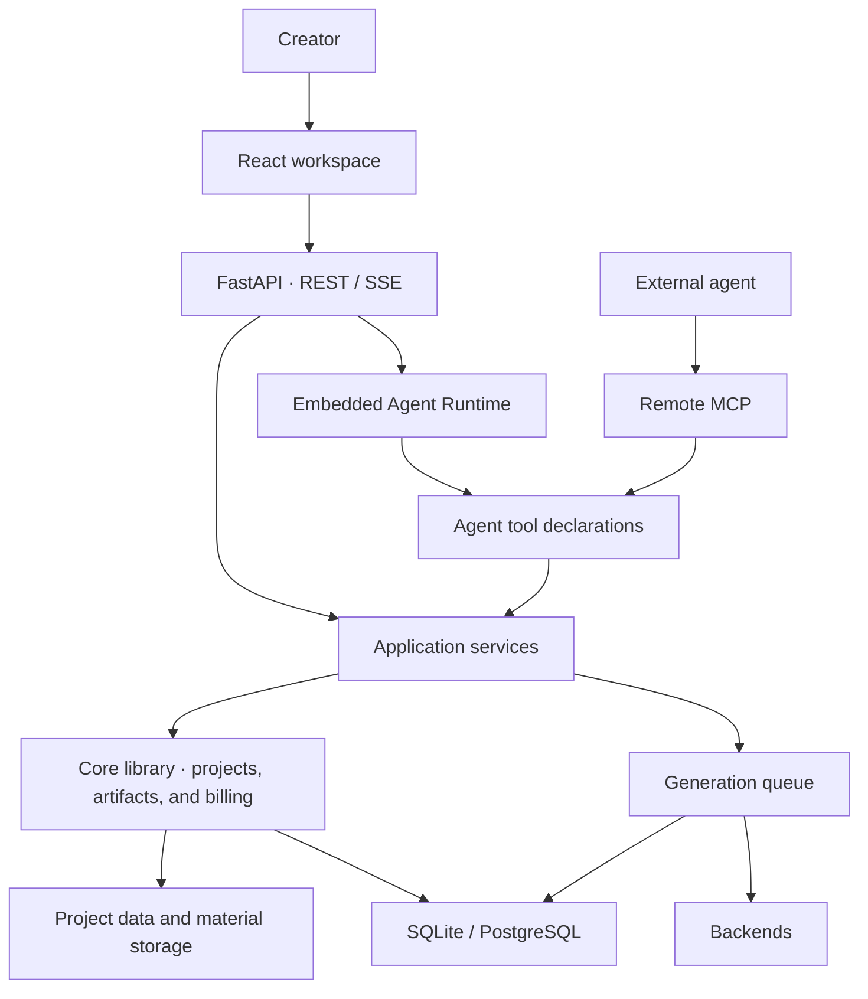

# Architecture {#architecture}

This page introduces ArcReel's system boundaries, data flow, and extension points for contributors. For local development and testing, see the [contributing guide](./contributing.md).

## System boundaries {#overview}

ArcReel organizes assets, scripts, generation, and editing into a reviewable production workflow. Each stage leaves results that creators can continue editing. Provider selection, billing, and recovery for external generation are independent of the creative workflow.

| Layer | Entry points and responsibilities |
| --- | --- |
| `frontend/` | The React workspace reads and writes projects and configuration over REST and receives conversation and project updates over SSE. |
| `server/` | Wires HTTP, the embedded Agent, and remote MCP, and coordinates use cases across domains. |
| `lib/` | Owns rules for projects, artifacts, and tasks and provides database, material storage, and provider access. |

### Core library and server boundary {#core-server-boundary}

Dependencies point from `server/` to `lib/`. The core library owns domain logic and infrastructure. The server owns HTTP routes, the SDK integration, SSE, and use case coordination. Simple routes can call the core library directly. Application services handle use cases shared across entry points or requiring coordinated transactions and compensation. The import-linter contracts in `pyproject.toml` check this dependency direction and keep HTTP frameworks out of the core library.

## Workspace and API {#frontend-layer}

`server/routers/` exposes HTTP endpoints for projects, tasks, and settings. Conversation SSE streams Agent replies, and project SSE tells the workspace when to reread a project while pushing lightweight `task_progress` events for running long-text queue tasks. Task queries and active task snapshots provide execution progress and restore the display after reloads, disconnects, or across projects. For reverse proxy configuration, see [Reverse Proxy and HTTPS](../ops/deployment.md#reverse-proxy-and-https).

`frontend/src/components` organizes interfaces by page and workspace. `frontend/src/stores` holds state shared across views. The backend determines task and artifact status. See the [frontend standards](https://github.com/ArcReel/ArcReel/blob/main/docs/standards/frontend.md) for layout, save, and refresh rules.

| Change | Entry points |
| --- | --- |
| Page layout and scrolling | `components/shared/page-shell`, `components/shared/master-detail`, and `components/layout/StudioLayout.tsx` |
| Settings deep links and return targets | `frontend/src/app-routes.ts` and `components/shared/page-shell/return-to.ts` |
| Project refresh and configuration issues | `frontend/src/stores/projects-store.ts` coalesces refreshes. Writes refresh through `components/canvas/shared/refreshAfterWrite.ts`. `frontend/src/stores/config-status-store.ts` exposes issues by settings section. |

### Edit units and navigation guard {#edit-unit-and-leave-guard}

`components/shared/edit-unit/useEditUnit` holds saved content, unsaved changes, and the save result. `LeaveGuardProvider` handles unsaved changes on navigation. Immediate actions are independent of the edit unit's save operation.

Forms place the save bar at the bottom of the page shell or detail pane. Canvas views show unsaved changes below the content they belong to.

## Agent Runtime {#agent-runtime}

`server/agent_runtime/` wraps the Claude Agent SDK for the embedded Agent. The main Agent interacts with creators and advances the project through workflow skills, subagents, and tools.

| Responsibility | Entry point |
| --- | --- |
| Select the next step, coordinate actions, and wait for confirmation | Workflow skills in `agent_runtime_profile/.claude/skills/` advance the workflow from project state. |
| Analyze long inputs, split units, or review material | Subagents in `agent_runtime_profile/.claude/agents/` receive focused tasks and return summaries and result references. |
| Read and write projects, submit tasks, and export | `server/agent_toolset/` declares the tool contracts. The embedded Agent and remote MCP register tools from the same declarations. [ADR 0087](https://github.com/ArcReel/ArcReel/blob/main/docs/adr/0087-agent-toolset-single-declaration.md) |
| Serialize session operations | `server/agent_runtime/session_actor.py` owns the session SDK client and queues turns, interrupts, and disconnects. [ADR 0028](https://github.com/ArcReel/ArcReel/blob/main/docs/adr/0028-session-actor-single-task-serialization.md) |

`agent_runtime_profile/` owns the creative Agent's skills, subagents, and per-content-mode `CLAUDE.*.md` files. `lib/agent/profile_manifest.py` materializes them in projects and identifies project-local edits. To change the creative behavior shipped with a release, start with the configuration source.

## Project data and materials {#project-and-asset-model}

Each project directory contains `project.json` along with source files, scripts, version records, and artifacts. `lib/infra/data_root_layout.py` defines where projects, the global asset library, and user memory live under the data root. See [Deployment and Operations](../ops/deployment.md) for backup and restore coverage.

Projects reference material identities. Material storage holds the bytes, and each provider asset association belongs to a specific content version. Changing only the storage location preserves the content identity and artifact currency. See [ADR 0108](https://github.com/ArcReel/ArcReel/blob/main/docs/adr/0108-material-storage-independent-of-provider-registration.md) and [ADR 0119](https://github.com/ArcReel/ArcReel/blob/main/docs/adr/0119-archives-carry-content-not-storage-locators.md).

`lib/db/` uses SQLAlchemy's async ORM to store runtime state such as accounts, credentials, and tasks. The server upgrades the database with Alembic at startup. See [Deployment and Operations](../ops/deployment.md) and the [database migration guide](../ops/migrate-to-postgres.md) for configuration and migration.

`lib/artifacts/` manages version records, current versions, and artifact registration. Creators can compare newly generated or imported versions with earlier versions and select an earlier version as current. ArcReel evaluates artifact currency against the recorded inputs. See [ADR 0062](https://github.com/ArcReel/ArcReel/blob/main/docs/adr/0062-artifact-lifecycle-and-currency.md).

## Requests, tasks, and billing {#generation-queue}

`lib/generation/` persists and schedules tasks. The generation worker limits image, video, and audio concurrency per provider. Text tasks share a process-wide limit of 16 in flight. The worker claims up to four text tasks per cycle, leaving the rest queued and cancellable. Each text task records the provider selected at execution time. Local rendering has a dedicated serial lane. Project state updates when a task reaches a terminal state.

Clients can use `GET /api/v1/tasks/active` to read queued and running tasks. The optional `project_name` query parameter limits the snapshot to one project. `GET /api/v1/projects/{project_name}/tasks/active` provides the same project snapshot. The response contains `items` and `truncated`. When more than 5,000 visible tasks are active, the snapshot returns 5,000 rows and sets `truncated` to `true`. The recent task list remains paginated by update time.

`POST /api/v1/tasks/lookup` takes a `task_ids` string array and an optional `project_name`. Each ID is processed once, and requests with more than 200 distinct IDs return HTTP 400. The `items` field follows the visibility and localization rules of the single-task endpoint. `missing_ids` contains IDs that do not exist or are outside the lookup scope. Task rows report `updated_at` in UTC ISO 8601 with microsecond precision. Retrying a download moves the task back to running with a strictly later timestamp than the failed row. See [ADR 0126](https://github.com/ArcReel/ArcReel/blob/main/docs/adr/0126-task-active-snapshot-and-asset-occupancy-guards.md).

Long-text queue tasks execute through a unified streaming runtime bounded by three wait limits: 15 seconds to connect, 180 seconds of idle stall without content or thinking deltas, and 900 seconds total. Hitting a limit ends local waiting with the `text_wait_timeout` error code and reports that the provider may still complete and charge for the request. The in-process worker keeps lightweight in-memory progress across three real phases—`waiting`, `receiving` (received character count or thinking state), and `retrying`—broadcasting throttled `task_progress` events with a per-task monotonic `seq` over the project SSE stream and attaching the latest progress to active task snapshots for reloads, reconnects, and cross-project views. See [ADR 0006](https://github.com/ArcReel/ArcReel/blob/main/docs/adr/0006-cancel-only-queued-tasks.md) and [ADR 0126](https://github.com/ArcReel/ArcReel/blob/main/docs/adr/0126-task-active-snapshot-and-asset-occupancy-guards.md).

Project asset writes and generation requests share an asset admission lock. If an upload, provider asset import, version restore, or asset identity change conflicts with an active task, the API returns HTTP 409 with the code `asset_resource_busy`. Retry after the task using the target finishes. Character sheets and reference audio have independent checks. Asset merges check both the source and the retained asset. Text edits, unchanged field values, voice notice acknowledgements, appending product reference images, and `dry_run` previews can proceed during generation.

When a generation batch includes both busy and idle asset sheets, busy items return `asset_resource_busy` and idle items can still be queued. The Agent sees the same reason when it reads the batch. When applying assets from the global library to a project, a provider asset link copy failure rolls back the whole batch and preserves the artifact manifest.

Task identity correlates results and costs. A resumed video task looks up the original job using its submitted context, avoiding a second submission and charge. See [ADR 0055](https://github.com/ArcReel/ArcReel/blob/main/docs/adr/0055-generation-route-locked-at-creation.md) and the [provider standards](https://github.com/ArcReel/ArcReel/blob/main/docs/standards/providers.md).

### Provider abstraction {#provider-abstraction}

Cross-media capability resolution and backend assembly follow a directed acyclic layering enforced by the `import-linter` contracts in `pyproject.toml`:

| Module | Responsibility |
| --- | --- |
| `lib/capabilities/` | Pure capability kernel (free of config, assembly, backends, database, or network dependencies) that evaluates catalog entries, endpoint protocol hard bounds, and capability overrides into immutable capability snapshots. |
| `lib/config/` | Low-level configuration reading for global/project settings, credentials, and project preferences, without cross-builtin/custom target selection, capability synthesis, or project capability projection. |
| `lib/backends/` and `lib/custom_provider/` | Text, image, video, and audio backend protocols, built-in and custom endpoint descriptions, standalone endpoint-definition decoding, and settings capability views. |
| `lib/video_runtime/` | Unified runtime layer for target selection and single-pass configuration resolution across built-in and custom providers, producing co-sourced capability snapshots and private assembly specs for text, image, and video, and private assembly specs for audio, shared by preflight, cost estimation, and execution across all four media types as well as in-flight resumption for video tasks. |

A provider model pairs an API model name with an endpoint. A catalog entry holds model facts and pricing, the endpoint declares protocol hard bounds and execution facts, and capability overrides express channel differences within those bounds. Video planning, preflight, reference cost estimation, and execution share the same pure synchronous video request-fact evaluation. See [ADR 0049](https://github.com/ArcReel/ArcReel/blob/main/docs/adr/0049-generation-context-single-resolution.md), [ADR 0086](https://github.com/ArcReel/ArcReel/blob/main/docs/adr/0086-video-request-facts-evaluated-once.md), [ADR 0099](https://github.com/ArcReel/ArcReel/blob/main/docs/adr/0099-model-catalog-shared-entries-per-model.md), and [ADR 0104](https://github.com/ArcReel/ArcReel/blob/main/docs/adr/0104-capability-sources-split-by-dimension.md).

For code entry points and upstream sources, see the [provider API index](https://github.com/ArcReel/ArcReel/tree/main/docs/api-docs). For setup, see [Providers and Models](../guide/providers.md).

### Cancellation and interruption {#cancellation-sources}

Creators can cancel queued generation tasks, and in-flight tasks continue when a client disconnects. When the service receives a shutdown signal, it immediately closes admission for new queued tasks and download retries, proactively closes active project-event and Agent-session SSE streams (clients reconnect and resynchronize automatically, while remote MCP streams exit under the same shutdown lifecycle), and waits in parallel within the shutdown grace period for in-flight generation tasks and resident Agent sessions to exit cleanly.

Timeouts or process termination past the grace period can interrupt in-flight generation. Shutdown does not actively cancel in-flight tasks on timeout; after a restart, video tasks that remain `running` with a recorded provider job ID and valid checkpoint on resumable backends automatically resume polling and download their original results, while other interrupted tasks are marked failed for the creator to retry. See `lib/generation/restart_recovery.py` for recovery and the [backend standards](https://github.com/ArcReel/ArcReel/blob/main/docs/standards/backend.md) for cancellation rules in threaded writes and settlement. Connection tests and Agent sessions have their own cancellation entry points. See [ADR 0006](https://github.com/ArcReel/ArcReel/blob/main/docs/adr/0006-cancel-only-queued-tasks.md), [ADR 0007](https://github.com/ArcReel/ArcReel/blob/main/docs/adr/0007-orphan-tasks-not-requeued-on-restart.md), and [ADR 0046](https://github.com/ArcReel/ArcReel/blob/main/docs/adr/0046-session-manager-decomposition-boundaries.md).

### Usage and cost {#usage-and-cost}

Backends report usage for actual provider requests. `lib/billing/` calculates costs from model catalog price tables and records usage and cost when a call finishes. Historical costs use the original records. Usage with unavailable pricing is marked unpriced, and each currency is totaled separately. See [ADR 0076](https://github.com/ArcReel/ArcReel/blob/main/docs/adr/0076-usage-record-is-projection-of-provider-calls.md) and [ADR 0100](https://github.com/ArcReel/ArcReel/blob/main/docs/adr/0100-price-table-meters-and-dimensions.md).

## Editing, rendering, and export {#video-composition-and-export}

An episode can have several named edit timelines. `lib/edit_timeline/` manages revisions and BGM placement, and clips follow the current content of their video units. Previews and exports use the same material versions, measured durations, audio, and subtitle timing from `server/services/presentation/`. See [ADR 0090](https://github.com/ArcReel/ArcReel/blob/main/docs/adr/0090-edit-timeline-named-follows-current-not-artifact.md).

`lib/final_cut/` renders final videos with the bundled FFmpeg. `lib/jianying_draft/` builds editable Jianying drafts. Both run in the local rendering lane, and artifact currency depends on the timeline revision and material versions used. See [ADR 0095](https://github.com/ArcReel/ArcReel/blob/main/docs/adr/0095-final-cut-rendered-locally-with-bundled-ffmpeg.md) and [Jianying Draft Export](../guide/jianying-export.md).

The Agent can use `inspect_images` and `inspect_video_units` to review selected material versions. Video contact sheets and machine-detected signals support review.

## Access control and sandboxing {#sandbox-and-security}

The workspace uses username and password sign-in to obtain a JWT. External agents call tools at `/mcp` using revocable `arc-` access tokens. The server returns the full token at creation and stores its hash. Settings links to the instance's `/agent-installation-guide.md` for connection steps. See [ADR 0065](https://github.com/ArcReel/ArcReel/blob/main/docs/adr/0065-remote-mcp-trusts-existing-api-keys.md).

`server/agent_runtime/agent_access_policy.py` defines the embedded Agent's access policy for the operating-system sandbox and SDK tool hooks. On Linux and macOS, startup requires a working sandbox. Native Windows uses a Bash command-prefix allowlist. See the [threat model](https://github.com/ArcReel/ArcReel/blob/main/docs/security/threat-model.md) and [Deployment and Operations](../ops/deployment.md) for guarantees and limits.

## Extension points {#related-docs}

Before changing behavior, check the [domain glossary](https://github.com/ArcReel/ArcReel/blob/main/GLOSSARY.md) and [architecture decisions](https://github.com/ArcReel/ArcReel/tree/main/docs/adr). Use the [coding standards](https://github.com/ArcReel/ArcReel/blob/main/CODING_STANDARDS.md) to check the boundaries touched by the change.

### Add a provider {#extend-provider}

1. Use the [provider API index](https://github.com/ArcReel/ArcReel/tree/main/docs/api-docs) to find the official protocol and existing code entry points.
2. Implement authentication, requests, results, and error handling in an endpoint or backend. For asynchronous calls, verify timeouts, polling, and resumption.
3. Maintain official models, capabilities, and prices in the catalog data repository. The release workflow updates the model catalog snapshot shipped with the application. See [ADR 0103](https://github.com/ArcReel/ArcReel/blob/main/docs/adr/0103-catalog-data-repo-built-from-third-party-sources.md).
4. Use the [provider standards](https://github.com/ArcReel/ArcReel/blob/main/docs/standards/providers.md) to verify entry points, requests, usage, and failure handling, and update the user-facing setup guidance.

### Add a workflow stage {#extend-workflow-stage}

Start with inputs, completion conditions, and artifacts that can be verified from project state. Define creator confirmation, billing admission, recovery, and version behavior. Implement the rules in the core library, expose the use case through the server, then connect the workflow skill or interface. Follow the [creative workflow](../guide/workflows.md) to verify that creators can see the stage status and advance to the next step.
